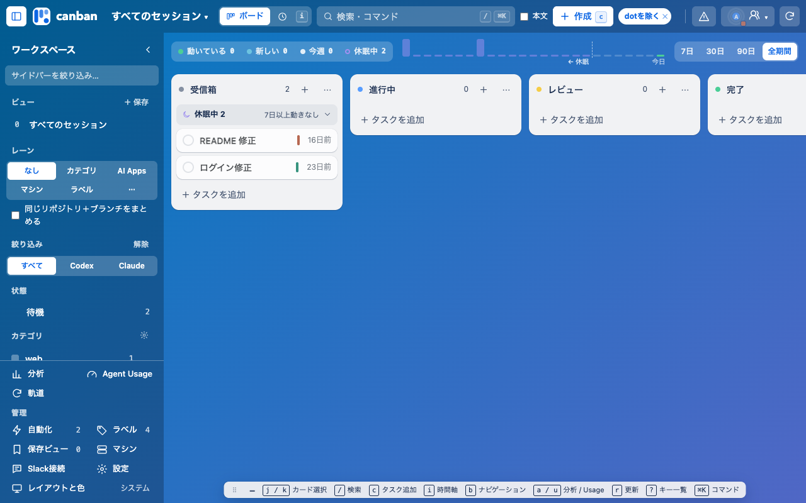
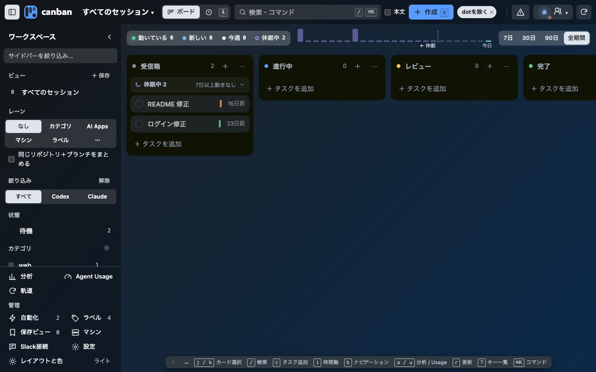
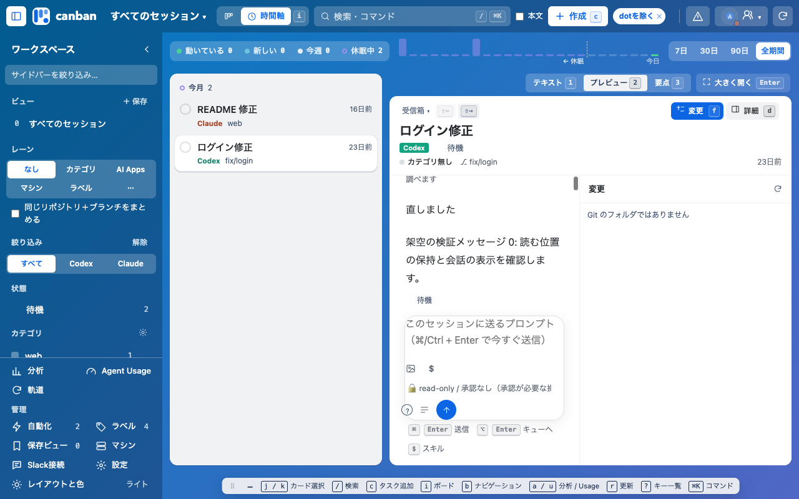
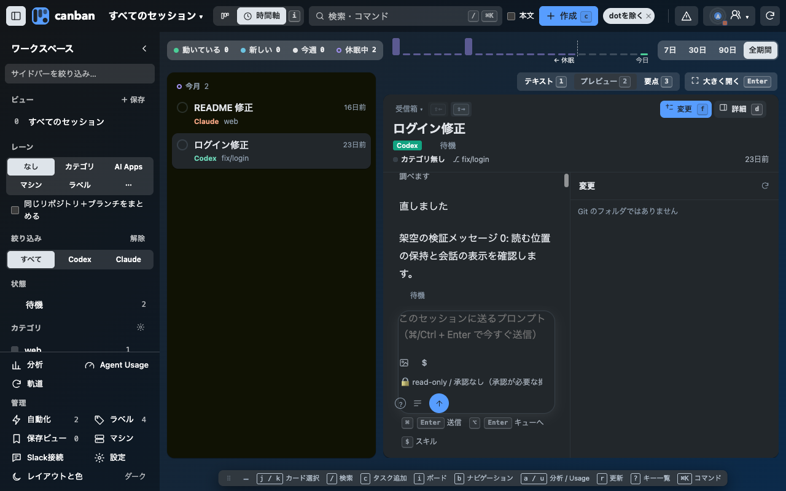

# 開発・公開ブランチの統合検証

`main` を開発用、`production` をChrome Web Store公開用（prod）として維持します。productionは0.27.1を保持し、ストア送信・申請は行っていません。開発用mainの分岐を統合し、旧時間軸プレビューの読む位置保持を共通カード詳細へ移しました。新しい操作・キー・権限はありません。既存の時間軸の右側のカードはレイヤー2です。

架空データと隔離Chromeを使い、1280×800でボード／時間軸とライト／ダークを確認しました。会話の再読み込み・再選択・別の会話から戻る操作後、両テーマで100pxの読む位置を保持しています。計測は[verification.json](verification.json)に記録しています。非同期読み込み待ち中のスクロール操作は、回帰テストでも確認します。

| | ライト | ダーク |
|---|---|---|
| ボード |  |  |
| 時間軸 |  |  |
