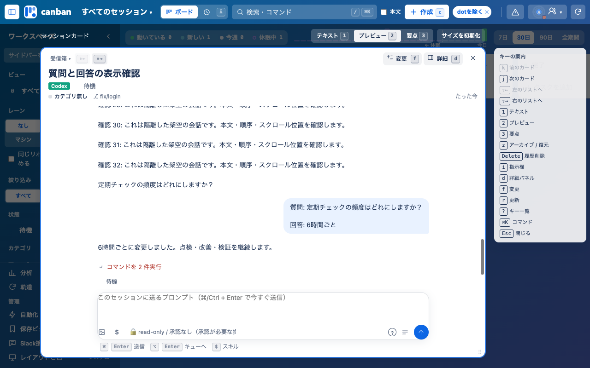
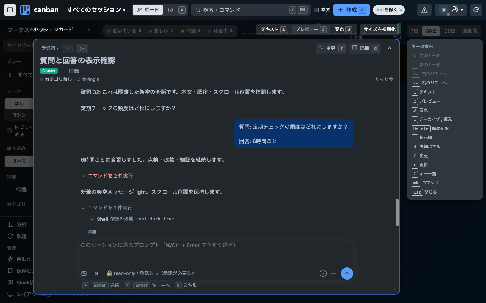
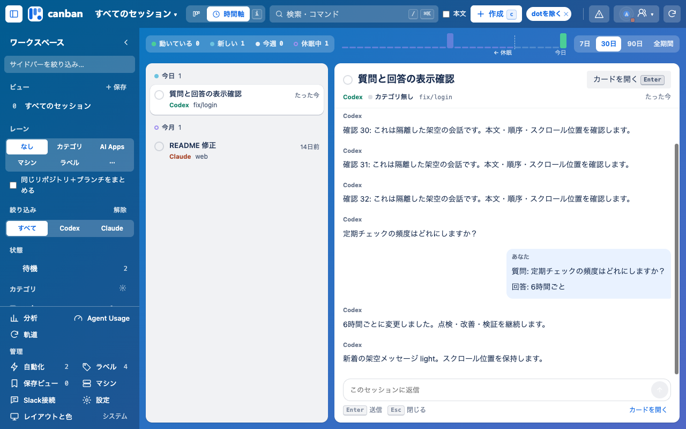
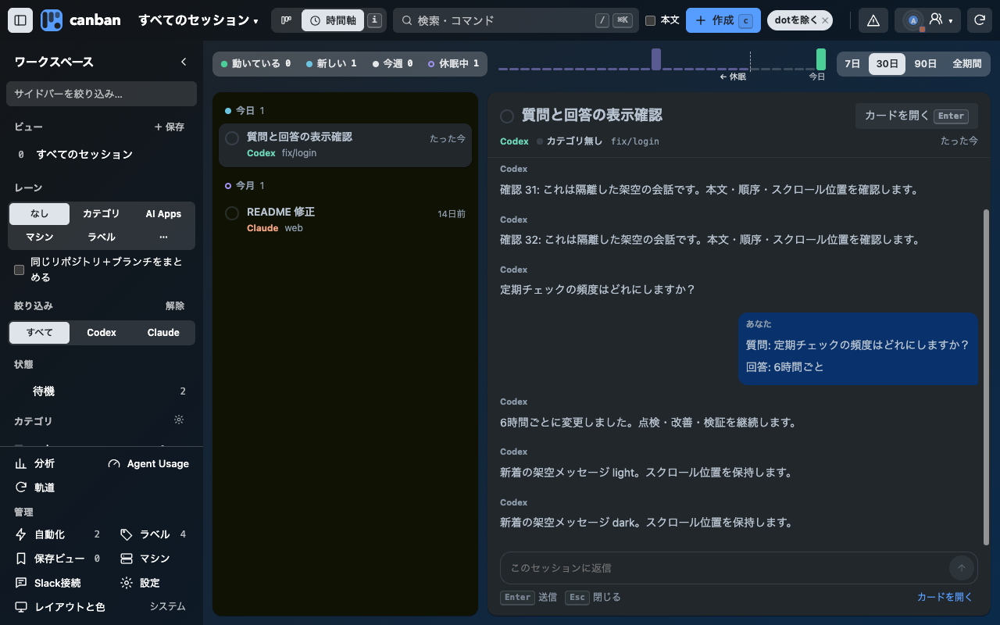

# 会話表示の修正（0.27.7）

最新origin/main f2f3a7eから、質問への回答・サイズ変更時のスクロール・後着ツール結果の3修正だけを分離しました。別PRのMeetings連携・文字サイズ変更は含めません。

## 検証

架空の会話、隔離Chrome、1280×800。npm testは412件成功、Chrome操作smokeは1件成功。成功/失敗の後着結果、下書きの再表示、入力フォーカス、新着受信時のスクロール、時間軸との本文一致をライト・ダークで確認し、ページエラーは0件でした。サイズ変更の3回帰テストも成功しています。

カードを開いて入力欄が使えるまでの時間はライト109ms、ダーク107ms（各1回）。性能改善の比較値ではありません。Codexは提供画像のみ、Claude Desktopの現在画面は未確認で、他製品を追い越したとは評価しません。

レイヤー2の既存部品を改善し、新しい操作・キーはありません。登録済みChromeの更新・再読込と公開は別工程です。

詳細は[計測結果](verification.json)。変更前後の記録はworktreeの.local/ui-ux-checks/2026-10-13/に保持しています。画面検証は最終PR基点で再実行しました。
