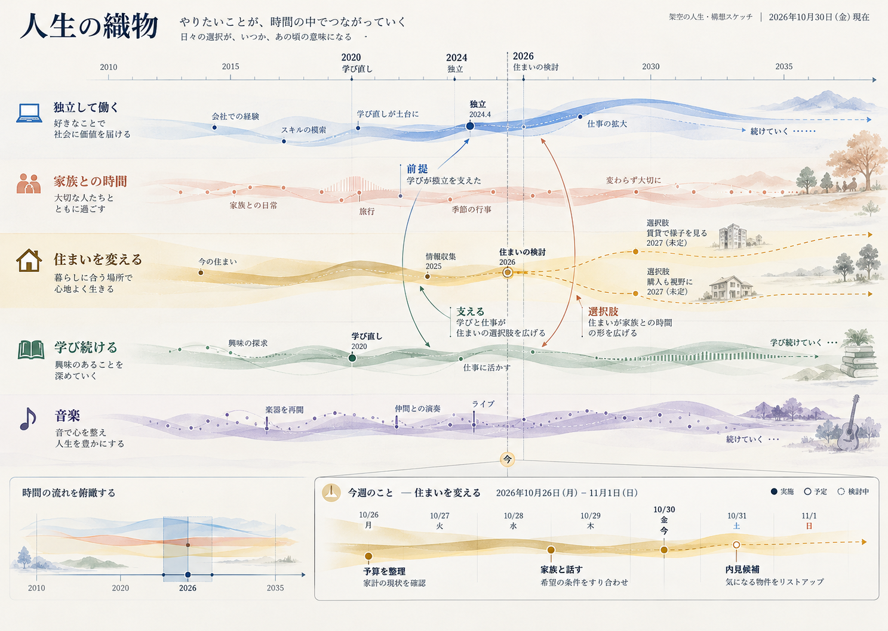
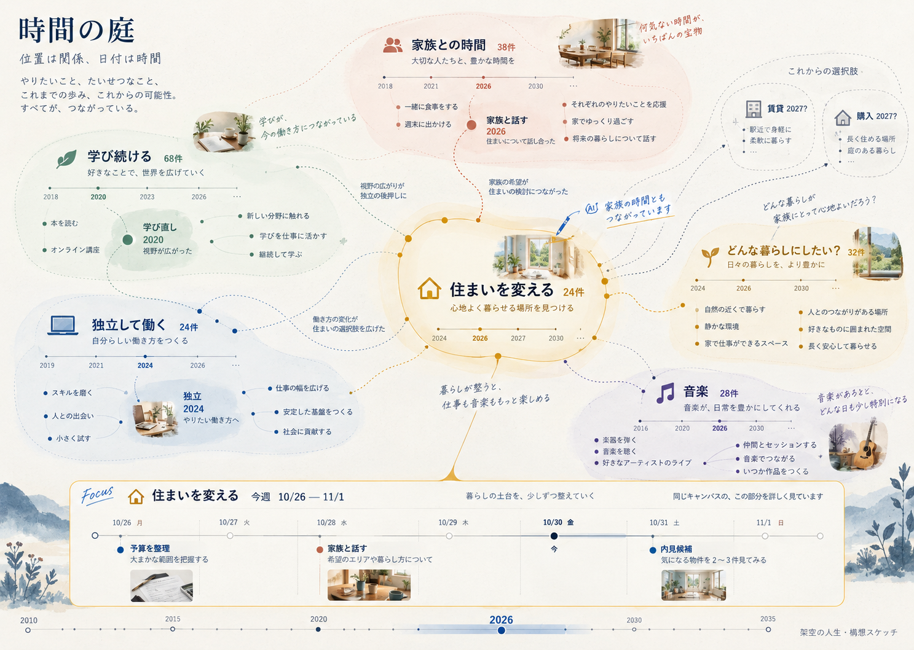
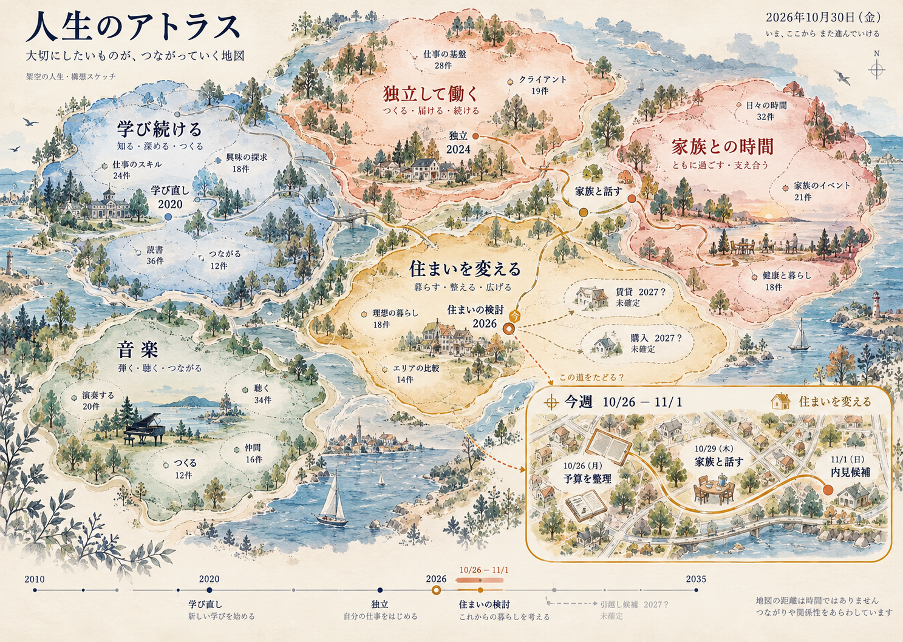
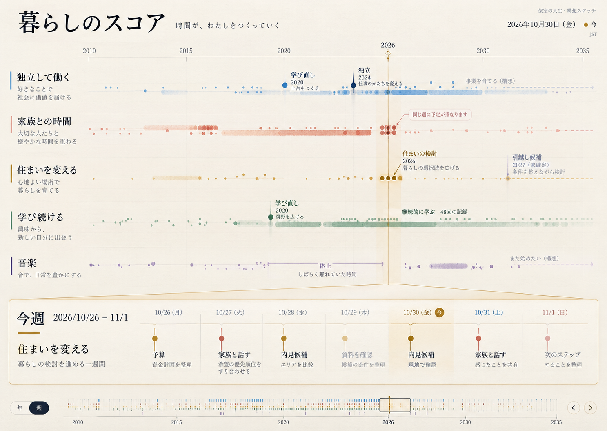
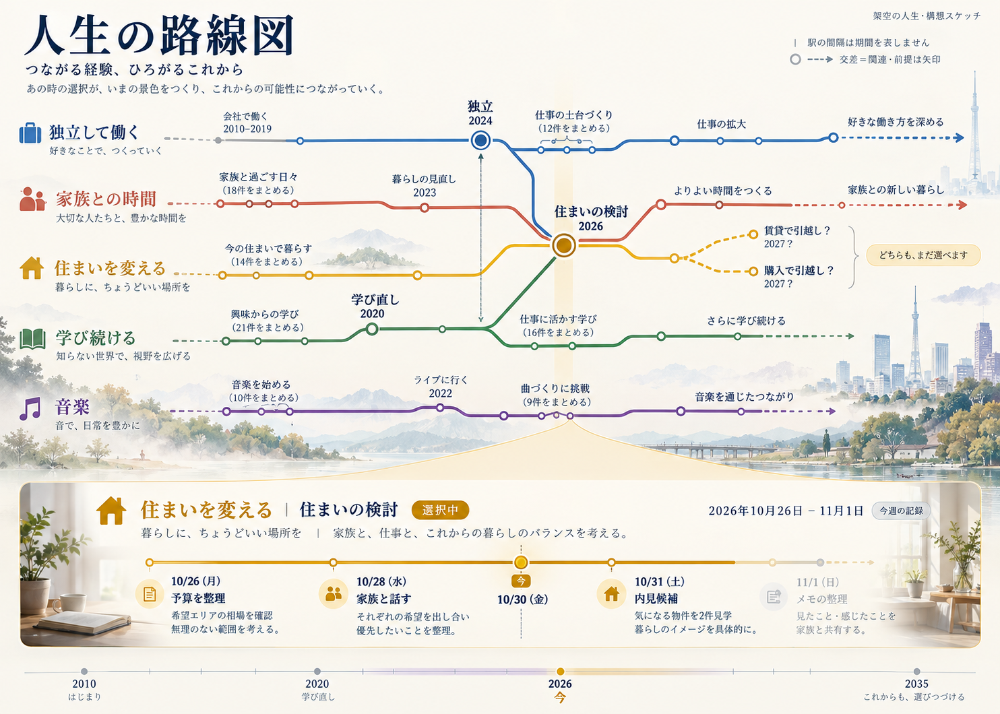
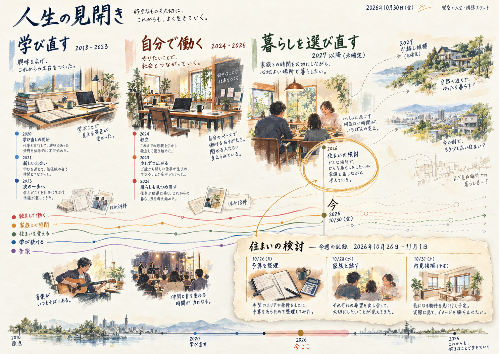

# ライフタイムラインの構想と保存スケッチ

2026年10月30日のユーザー・Codex・Claude Desktopの共同検討を記録する。Canbanを、人生の課題に伴走する舞台へ広げるための設計資料であり、機能の実装完了を示すものではない。

## 今回の方向

メニューや分類が主役の管理画面から、人生の広がりを見渡せる1枚の大きなボードへ発想を移す。ガントの時間の正確さ、マインドマップの自由さ、地図の俯瞰、グラレコの物語性を、同じ課題と履歴に対する表現として検討する。

ユーザーの追加案を設計の中心にする。

1. 横軸は時空間ライン（いつ、どこで）。
2. 縦軸はターゲットライン（なにをしたいか、なにをしたか）。
3. 交点・ドットに課題を置く（なぜ、どのように、どのくらい、だれと）。
4. コスト（時間・お金など）は大きさ・太さ・色・形でも語れるようにする。

[実装提案](implementation-proposal.md)に、データ、表示、既存コードへの接続、段階的な導入、検証条件をまとめた。[構想用語](CONTEXT.md)は未実装の概念を現行用語から区別する。

## 保存した6枚

表示された順番で保存した原寸のPNG。生成物には日付・文章・凡例の揺れがあり、そのまま実装仕様や実データとして使わない。すべて架空の人生を描いた静止構想画で、操作可能なプロトタイプではない。

| 番号 | 案 | 得意な読み方 | 注意する点 |
|---|---|---|---|
| 1 | 人生の織物 | 期間、継続、分岐、同時進行 | 関係の糸は選択周辺だけにする |
| 2 | 時間の庭 | 問いを広げる、多重所属を辿る | 空間の距離は経過時間を表さない |
| 3 | 人生のアトラス | 領域とつながりの全体を見渡す | 地形は重要度・成果・記録量の順位を表さない |
| 4 | 暮らしのスコア | 反復、並行、明示的な休止を読む | 音楽記号の知識を必要としない |
| 5 | 人生の路線図 | 前提、乗り換え、選択肢を辿る | 線の交差だけで依存や因果を断定しない |
| 6 | 人生の見開き | 章、転機、本人の記憶を振り返る | AIが人生の意味を確定しない |

### 人生の織物

### 時間の庭

### 人生のアトラス

### 暮らしのスコア

### 人生の路線図

### 人生の見開き

## 出所と保存確認

- 作成日：2026年10月30日（日本時間）。ImageGenで各案を個別生成。
- [Claude Desktopとの共同検討](https://claude.ai/chat/a93bd7c4-1ec4-4c33-a9ef-909d3c21958c)。構図6案の批評、川から楽譜への差し替え、時空間・コストモデルのレビューを実施。
- PNGを変更せずに複製した。元のファイル名、保存ファイル名、サイズ、SHA-256は[保存台帳](sketches.json)にある。
- ユーザーは前の管理画面型スケッチを退け、この6案を「おもしろいスケッチ」と評価し、それぞれの保存・記録を依頼した。6案のうち1案の実装を選択したという意味ではない。
- 表現の共通条件は、舞台を主役にすること、長期俯瞰と短期詳細をつなぐこと、未来の可能性を事実と分けること、未記録を失敗と扱わないこと。
