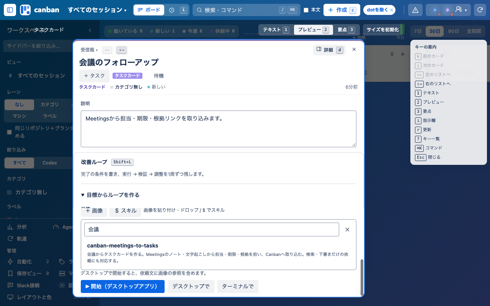
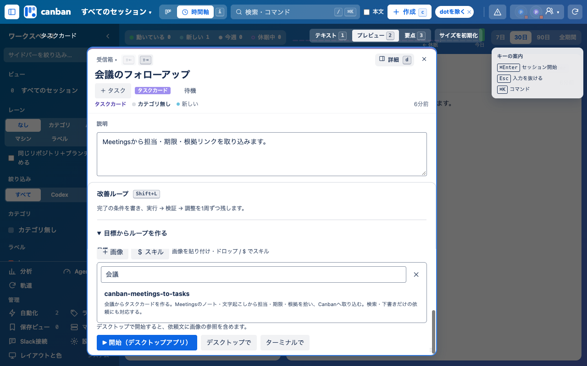
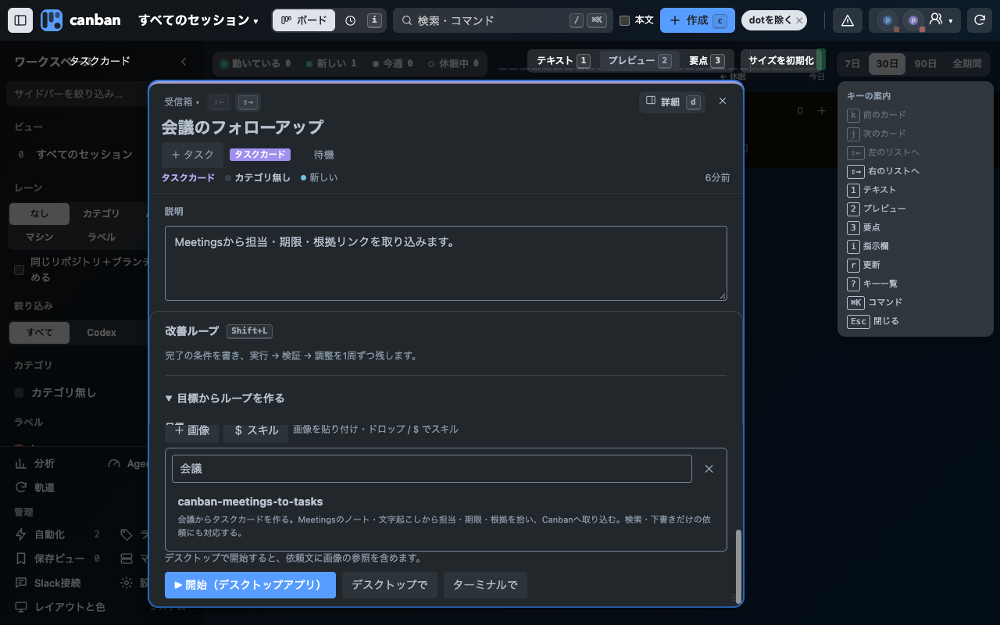
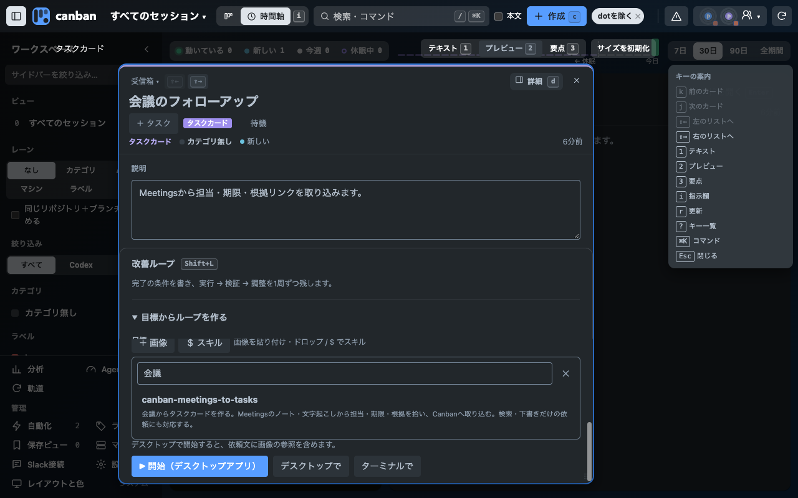

# Meetings連携の検証（2026-10-12）

Canban 0.27.2。Codexの共通入力欄で `$` または⌘Kの「スキルを選ぶ（Meetingsなど）」から既存ピッカーを開き、`canban-meetings-to-tasks` を選ぶ。レイヤー4。ページ・配置・録音ボタンは追加していない。

## 実呼び出し

Codex CLI 0.162.1。Canbanの `headlessArgs` と `cleanEnv`、`withSkills` を使い、検証専用のCLIセッションを再開した。`meetings.find_all` に `2099-01-01T00:00:00Z` / `2099-01-02T00:00:00Z` を送り、`results: []` / `has_more: false`、エラーなしの応答と `turn.completed` を確認した。既存会議のノート・文字起こしの読取や、実データへのカード作成は行っていない。

最初の試行は補助MCP Headroomの仕様取得が承認を要求し、Canbanと同じ `approval_policy=never` で停止した。そのツールを試験プロセスの `-c mcp_servers.headroom.enabled=false` だけで除外して再試験した。`read-only` と `approval_policy=never` は維持。本体は補助ツールを無効化しない。利用者の補助MCP構成によっては同じ停止があり得る。

Meetingsのインストール済み0.8.77ではローカルMCPの `meetings.start` / `meetings.takeNotes` が app-only user gesture。Canbanはこれを呼び出さず、録音はMeetings画面で本人が開始する。録音・権限要求・音声アップロードはこの検証で実施していない。Codex画面へのComputer Useは安全判定で拒否されたため、実機UIの録音確認は未実施。

## 画面と保存

隔離した開発ホストの1280×800、ボード・時間軸、ライト・ダークで、スキル検索・選択と⌘Kから同じピッカーへ到達することを確認した。架空のタスクを同じ `clientRequestId` で2回作成し、同じcardIdが返ることも確認した。実会議の内容抽出の精度、実アカウントのノート取り込み、Chrome登録済み拡張の再読み込みは別の受け入れ確認。

`npm test` は400件すべて成功（skipなし）。`node --test tests/board-smoke.browser.mjs` は1件成功（skipなし）。配置・CSSの変更はない。ログと検証用データはGit管理外の `.local/meetings-verification/` に置く。

| ボード | 時間軸 |
|---|---|
|  |  |
|  |  |

## 根拠

- [公式App Server](https://learn.chatgpt.com/docs/app-server)：app/installed、app mentions。
- インストール済み `chatgpt-meetings/0.8.77` の `README.md` と `scripts/meetings_mcp.py`：ノート検索用の接続アプリと、ローカルの録音操作の契約。今回の確認元はこのパッケージであり、公開リポジトリの取得はしていない。
- 実行ログ `resume-without-headroom.jsonl`：`codex_apps` の `meetings.find_all` が `status: completed` / `error: null`、続いて `turn.completed`。画面検証ログ `capture-result.log` は4種の表示と作成IDの重複防止を記録。
