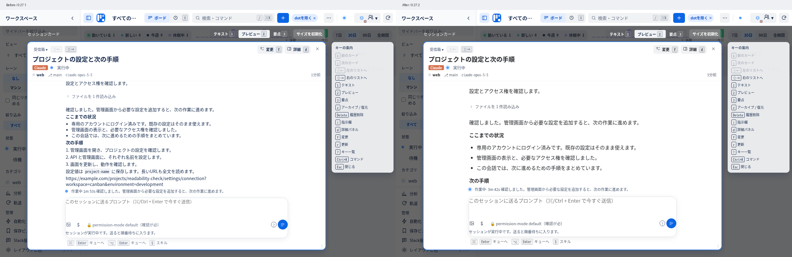

# 会話の可読性 — 0.27.2

添付されたデスクトップ画面で示された「Canbanの会話は文字が小さく、行間が詰まって読みづらい」という課題を、既存の会話・カードのCSSで改善した。

| 対象 | 変更前 | 変更後（標準の文字サイズ） |
|---|---|---|
| カード詳細の会話本文 | 14px / 行間19px | 16px / 行間28.8px（1.8倍） |
| 段落の間隔 | 4.2px | 12px |
| 本文の最大幅 | 720px | 672px（42rem） |
| 本文の色（ライト） | 青みのある文字 | 濃いグレー |
| 本文の色（ダーク） | 薄い青グレー | 明るいグレー |
| ボード・時間軸のタイトル | 14px / 13.5px | 15px |

本文・入力欄と本文幅は共通のトークンに揃えた。ブラウザの標準文字サイズを反映するremと、拡大時も比例する行間を使う。長いURLは折り返し、本文の日本語は単語を強制分割しない。アイコン、機能、操作の入口、キー、保存済みカードの幅・高さは既存のものを使用する。

## 比較画像

- 会話: [ライト・変更前](before-session-light.png) → [変更後](after-session-light.png)、[ダーク・変更前](before-session-dark.png) → [変更後](after-session-dark.png)
- 本文の拡大確認: [ライト・変更前](before-text-light.png) → [変更後](after-text-light.png)、[ダーク・変更前](before-text-dark.png) → [変更後](after-text-dark.png)
- ボード: [ライト](after-board-light.png)、[ダーク](after-board-dark.png)
- 時間軸: [ライト](after-timeline-light.png)、[ダーク](after-timeline-dark.png)
- 詳細パネル: [ライト](after-details-light.png)、[ダーク](after-details-dark.png)
- [文字サイズ2倍](after-large-text.png)、[390px幅](after-narrow.png)

## 検証

- 隔離した開発ホストの架空のClaude会話を、Chromiumで実際に表示した。アカウント・作業フォルダは架空で、指示の送信は行っていない。
- 1280×800、deviceScaleFactor 1。ライト／ダークのボード・時間軸・会話・詳細パネルを撮影。本文の拡大画像は実際のfeed領域を撮影し、サイズ変更はしていない。
- 5レイアウト×2テーマで本文16px・行間28.8px、横にはみ出さないことを実測した。レイアウト切替とカードを閉じて開き直す操作で下書きを保持した。
- テキスト／プレビュー／要点、ツールの開閉、会話内のスクロール、Esc、標準文字サイズ2倍、390px幅を確認。ブラウザの未処理エラーは0件。
- 本文／補助情報とカード背景のコントラスト比は、ライト15.00:1／6.27:1、ダーク12.05:1／7.03:1。
- `npm test`: 398件、395件成功、3件スキップ、失敗0件。
- `node --test tests/board-smoke.browser.mjs`: 成功。Linux用Chromiumを`CANBAN_BROWSER_EXECUTABLE`で指定して実行。
- `npm run build:chrome`: 成功。ビルドのmanifestも0.27.2で、生成CSSとソースの変更内容が一致。
- 追加実行した`tests/conversation-scroll.browser.mjs`は、旧式の部品を組み立てる検証コードが`window.fixture.list`を取得できず失敗した。変更前のHEADを隔離して実行しても同じ5ケースで再現するため、今回のCSSによる退行ではない。現行の会話は上記の実ブラウザ検証で確認した。

実測値は[変更前](before-metrics.json)、[変更後](after-metrics.json)、[操作・配置の検証](verification.json)に記録。設計確認は[design-qa.md](../../../design-qa.md)に記録した。

Macの登録済み拡張や導入済みプラグインはこのクラウド環境から更新していない。通常checkoutのmainへの取り込み後に、既存の`npm run update:local`で反映する。

## Macのローカルmainへの統合（0.27.3）

取り込み元は `origin/work` の `1f8d97dc1726e47052bdab0be6f3db91e3a1fb5c`（クラウド作業版0.27.2）。Meetings連携の0.27.2を保持して統合版を0.27.3に揃えた。取り込む5ファイルのCSSは元コミットと一致する。

Macでは `npm test` が400件すべて成功、`node --test tests/board-smoke.browser.mjs` が1件成功（どちらもskipなし）。テストデータ・統合版のログ・画像はGit管理外の `.local/readability-local-update/` に保存する。登録先の更新は、このMacのローカルmainから `npm run update:local` で行う。
