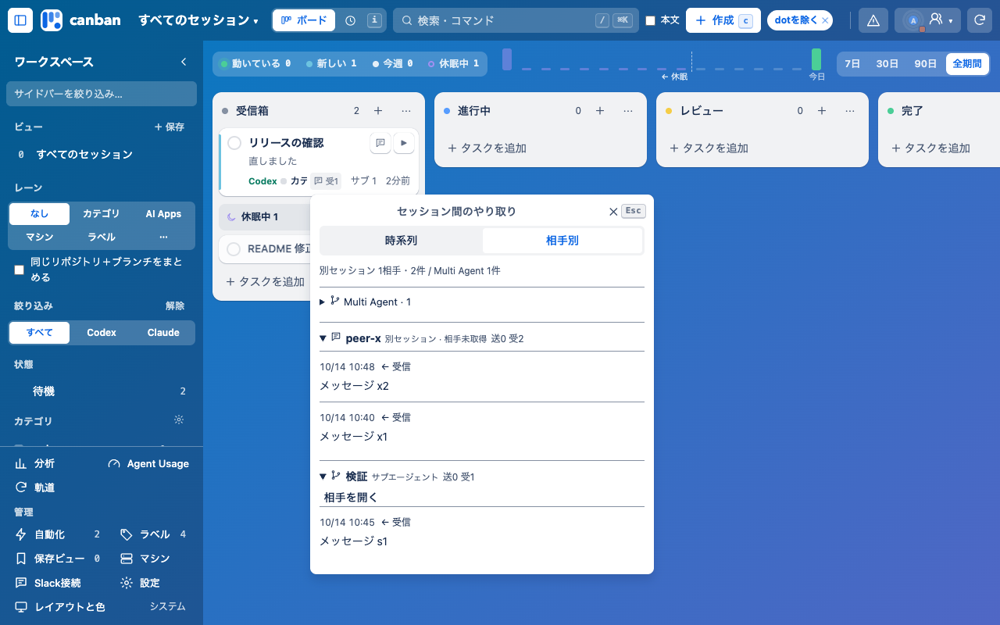

# セッション間のやり取り — 実装検証

2026-10-14、0.27.12を基準にした作業ブランチ `codex/session-exchanges` の実装版0.27.13。既存カードの吹き出しから、レイヤー4のポップオーバーで「時系列／相手別」を切り替える。相手別は折りたためる。別セッションと実際のMulti Agentの起動関係を区別する。

## 検証結果

- `npm test`: 455件成功、失敗0件。
- `CANBAN_SMOKE_SHOTS=.local/verification/session-exchanges node --test tests/board-smoke.browser.mjs`: 実Chromeで1件成功、失敗0件。吹き出し、切替、反復メッセージ、折りたたみ、Shift+M、Esc、ページエラーなしを確認。
- `npm run build:chrome`: 成功。生成したCSS/JSとソースから組み立てたCSS/JSの内容が一致。package、manifest、plugin、生成したChrome manifestは0.27.13。
- `git diff --check`: 問題なし。
- 独立レビューの受信形式、旧／新ログの重複、自己をエージェントとして数える問題を修正して回帰テストを追加した。実際のローカル受信ログでも、3件の固有の受信を確認した。
- カードの属性が多い場合にも送受信数が省略されず、時刻がカード内に収まることを実Chromeで確認した。

## 1280×800の実装画面

隔離したテスト用データで撮影した画面。実ユーザーの会話やタスクではない。ボード上の吹き出しと時間軸の行から、同じ履歴を確認できる。

| 表示 | 時系列 | 相手別 |
|---|---|---|
| ボード・ライト | [画像](board-light-timeline.png) | [画像](board-light-peer.png) |
| ボード・ダーク | [画像](board-dark-timeline.png) | [画像](board-dark-peer.png) |
| 時間軸・ライト | [画像](timeline-light-timeline.png) | [画像](timeline-light-peer.png) |
| 時間軸・ダーク | [画像](timeline-dark-timeline.png) | [画像](timeline-dark-peer.png) |

## 取得範囲と反映範囲

履歴取得はローカルログの読み取り専用。受信の記録を根拠に両側の送受信を表示し、既読化・移動・送信は行わない。初回は各ログ末尾256KiB、最大1000イベント、本文は最大4000文字を取得し、一部取得を表示する。相手を取得できない場合はその旨を表示する。依頼の完了や返信を推測しない。

リモート／クラウドの履歴取得、実メッセージの送信、登録済みChrome拡張への反映は未検証。mainへの取り込み・登録済み拡張更新・公開は実施していない。

[設計と仕様](../session-exchanges.md)
