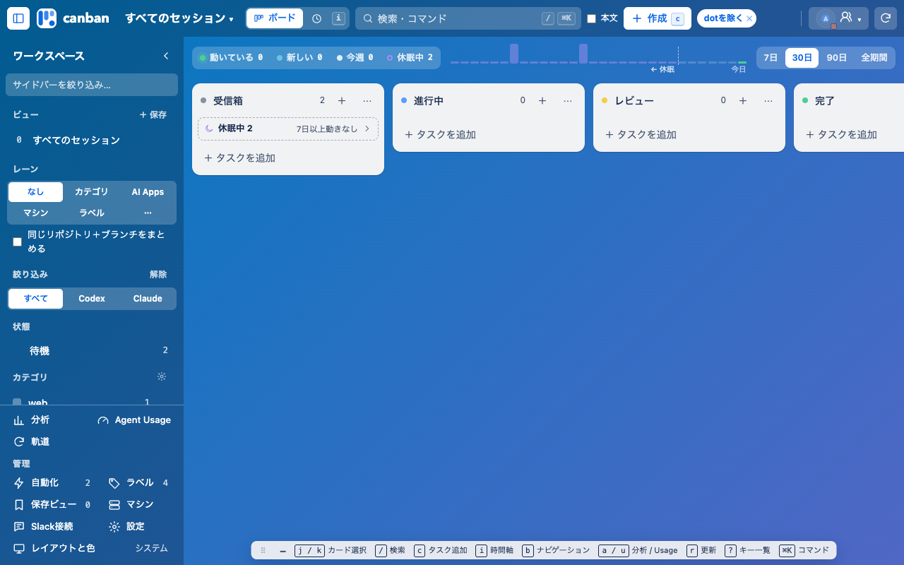
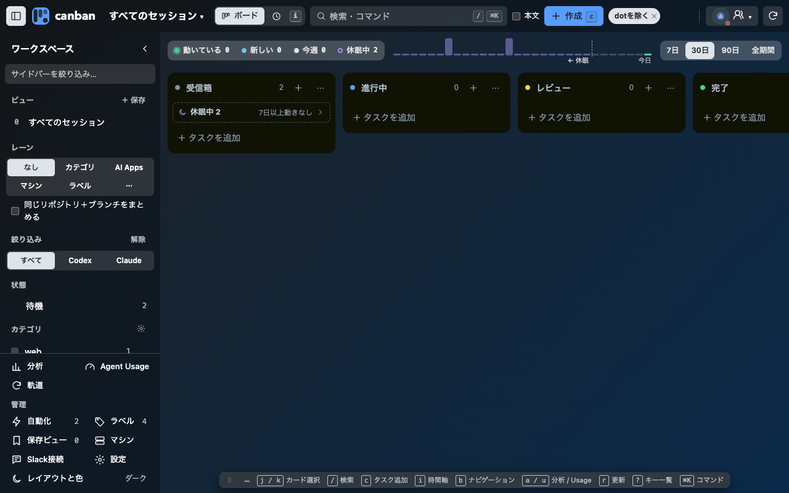
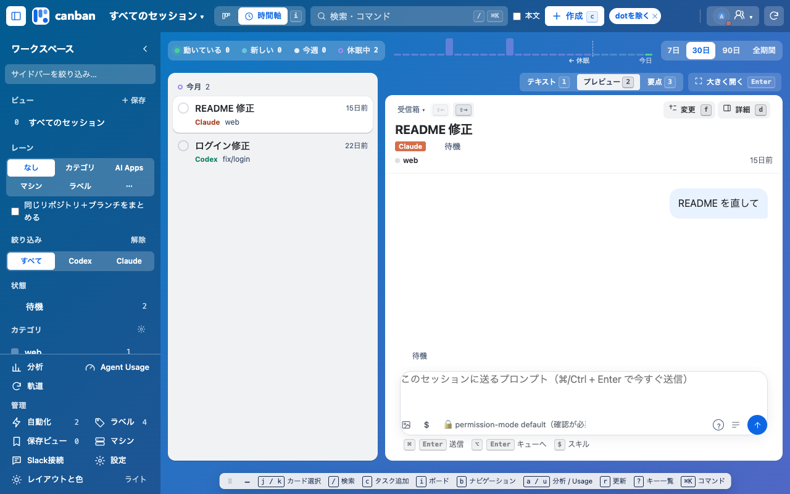
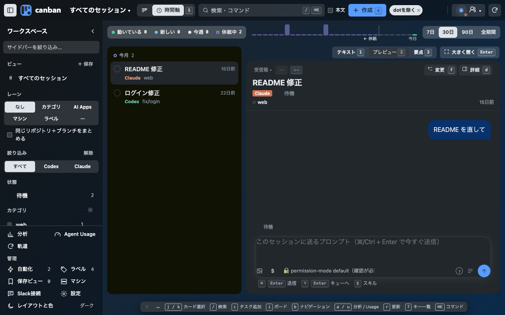
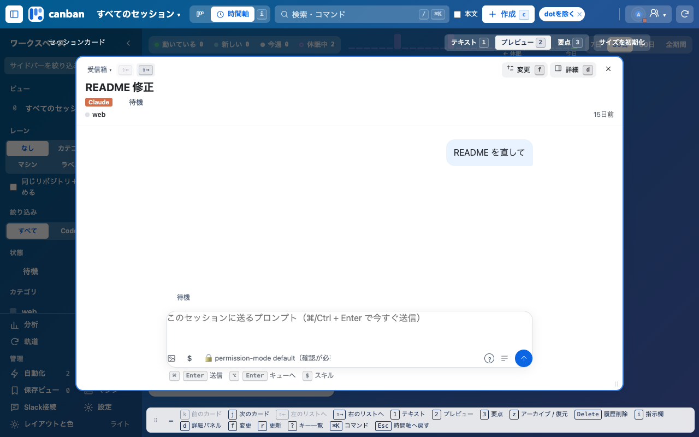
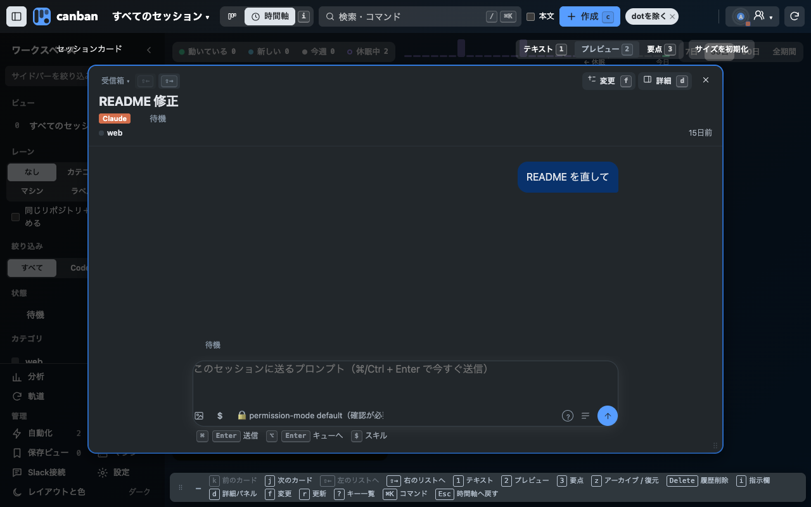
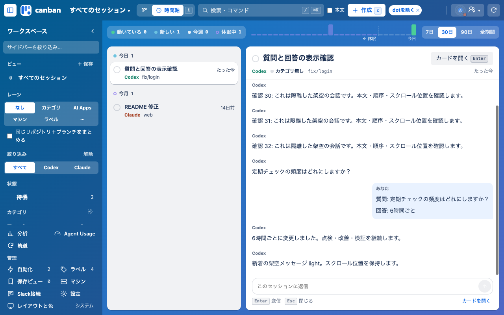
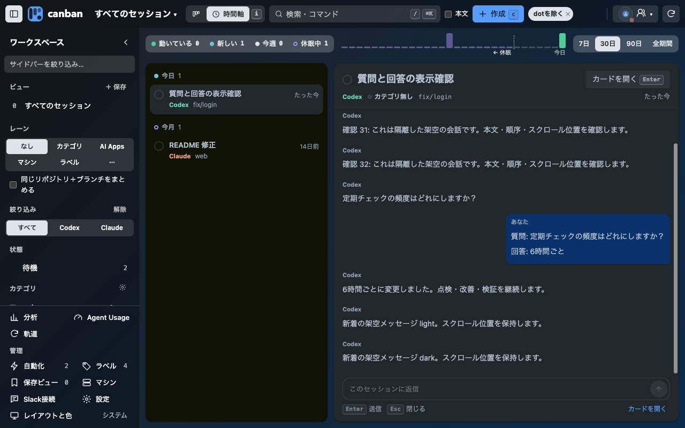

# 時間軸のカード表示とキーの案内 — 0.28.0

「右側はカードそのもの」と「キーの案内を全画面で1つに」を0.28.0で実装した。要点の表示・自動化の指示の畳み込み・本文の調整・一覧の幅のドラッグは未実装。

プレビュー: [preview.html](preview.html)（上の帯で 提案／現状、時間軸／ボード／カードを開いた状態、ライト／ダークを切り替え）

## 課題

- 時間軸の右側（`.inbox-main`）はカード詳細とは別の簡易プレビューで、文字が小さく、灰色の箱が続き、誰の発言かが分かりにくい。自動化の heartbeat 指示（XML タグ込み）が「あなた」の発言として全文出る。
- キーの案内が画面ごとに別の部品・別の場所にある。ボード・時間軸は右下の1行（`.board-shortcuts`）、カードを開くと右の余白の縦パネル（`.shortcut-map`）。

## 提案

1. **時間軸の右側は「カードそのもの」**：カード詳細（スレッド型）を時間軸の右にそのまま開く。見出し・属性の1行・会話・入力欄・詳細パネル `d` がオーバーレイと同じになる。`Enter` は「大きく開く」（オーバーレイ）。
2. **まず要点**：`1` テキスト / `2` プレビュー / `3` 要点 を時間軸でも使う。要点では先頭に「結果・確認済み・残り」を出す。
3. **自動化の指示は1行に畳む**：「⚡ 自動化の指示 · automation_id · 時刻」として畳み、押すと展開。人の発言は右寄せの吹き出し、エージェントは枠なしの本文。
4. **読みやすい本文**：0.27.2 の読みやすさのトークン（16px・行間1.8・42rem）を守り、パス・ハッシュはコード体で折り返す。日付の区切りを入れる。
5. **キーの案内は全画面で1部品・1か所**：ボード・時間軸・カードを開いた状態で同じ「キーの案内」を同じ位置に出し、中身だけ文脈で変える。見出しをドラッグして 右上・右下・左下・下端の帯 に吸着（矢印キーでも移動、`–` で畳む）。置いた分だけボードを押し出し、カードを覆わない。位置は共有 UI 状態（例: `keyGuide: { dock, min }`）に保存。
6. **一覧の幅もドラッグで**：時間軸の一覧とカードの境目をドラッグで調整し、共有 UI 状態に保存。

## 実装の見通し

| 変更 | 主なファイル |
|---|---|
| 時間軸の右側をカード詳細の部品で描く（`peekContent` → スレッド型カードの埋め込み） | `ui/inbox.js`、`ui/thread.js`、`ui/card-overlay*.js`、`ui/inbox.css` |
| 自動化の指示の畳み込み・要点の表示 | `ui/thread.js`、`ui/thread.css` |
| `.board-shortcuts` と `.shortcut-map` を1つの `keyGuide` に統合し、ドッグとドラッグを追加 | `ui/keyboard.js`、`ui/card-board.js`、`ui/header.css`、`ui/card-overlay.css`、`ui/state.js` |
| 呼称・レイヤー・キーの追記 | `docs/ui-components.md`、`AGENTS.md`（キーの案内の位置の決まり） |

## 実装（0.28.0）

- 時間軸の右側（`.inbox-main`）は場所を取るだけにし、カードオーバーレイの層（`#paneLayer`）を `.docked` にしてその上に重ねる。背景は暗くせず、一覧は操作できる。カードはオーバーレイと同じ部品なので、会話・入力欄・詳細パネル・ライブ更新・下書きの保持が共通。
- 一覧の `j` `k` で右のカードが切り替わり、`Enter`・ダブルクリックで大きく開く。大きく開いたカードの `Esc` は閉じずに右側へ戻す。右のカードの中の `Esc` は一覧へ戻る。アーカイブ・削除は閉じる。
- `.board-shortcuts`（ボードの右下）と `.shortcut-map`（カードの右余白）を `.key-guide` 1枚に統合した。中身は `refreshShortcutHints()` がフォーカスに合わせて変える。見出しのドラッグか矢印キーで 右上・右下・下端・左下（既定は下端）。置いた側の分だけ `.stage` とカードボードを空ける。位置は共有 UI 状態 `keyGuide`。

| | ライト | ダーク |
|---|---|---|
| ボード |  |  |
| 時間軸（右にカード） |  |  |
| 大きく開いたカード |  |  |

- キーの案内を右上へ: [時間軸](timeline-guide-right-light.png)、[大きく開いたカード](overlay-guide-right-light.png)。ドラッグ中の吸着先: [guide-drag-light.png](guide-drag-light.png)
- 画像は架空のテストデータ（`tests/helpers.mjs` の `makeFixtures()`）で1280×800、deviceScaleFactor 1。右のカードが `.inbox-main` と同じ位置・幅に重なること、キーの案内がカードに重ならないこと（右上・下端・大きく開いた状態）、ページのエラーがないことを確認した。

---

## 旧プレビューの読む位置（0.27.12、統合前の検証）

時間軸の会話プレビューを再描画すると過去のメッセージから末尾へ戻される問題を修正しました。セッションごとの読む位置を画面内メモリーへ保存し、末尾だった場合だけ追従します。タスク・読み込み表示は前のセッション位置を上書きしません。

## 再現と検証

隔離Chromeと架空の会話、1280×800、ライト・ダークで同じ操作を実行しました。時間軸の行を選び、10pxへ読み戻して同じ行を再選択します。変更前は両テーマで10→73px（63pxの意図しない移動）、変更後は10→10px（0px）。再読み込みボタンでも10→10pxで、下書きも保持しました。カードを開く・入力フォーカス・閉じる・新着時のスクロール・ボードと時間軸の本文一致を確認し、ページエラー0件でした。

4件の回帰テストは過去の位置・末尾追従・会話別の位置・タスク経由を確認します。Chrome smokeとビルドも成功しました。npm testは全441件成功しました。

レイヤー1の既存部品を改善しました。新しい操作・キー・権限・保存先はありません。Codex/Claude Desktopを追い越したという評価は行いません。登録済みChromeの反映と公開は別工程です。

[計測結果](verification.json)。変更前後の操作ログ・画像はworktreeの.local/ui-ux-checks/2026-10-13/に保持しています。

0.29.3では右側をカード詳細へ統一し、読む位置の保持をカード詳細の再描画・再選択へ引き継いでいます。上記の計測と画像は旧プレビューの検証記録です。

## やり取り表示との統合（0.29.5）

読む位置の保持と最新mainのカード表示を維持し、時間軸の行からセッション間のやり取りを開けるようにした。[初期の読む位置の記録](reading-position-0.27.12.md)。
