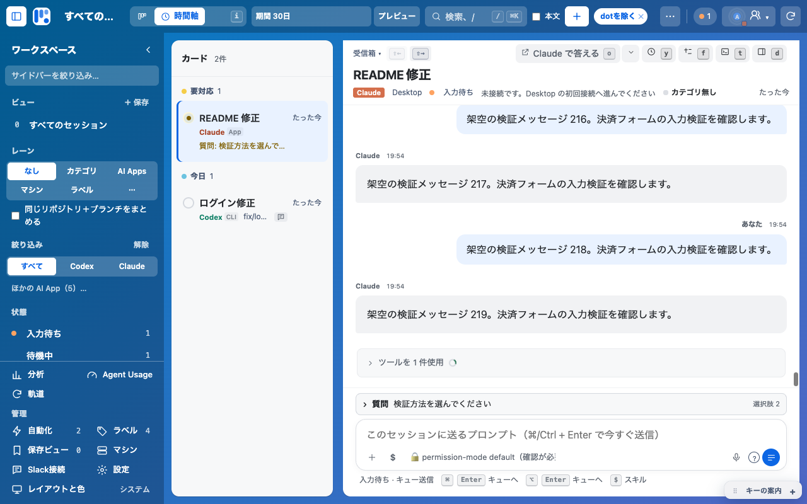

# 統合作業環境の実装と検証

2026-11-14。0.29.80。基点 `origin/main f87e3db4bbb7754ffcd2b5657539a3f0fadccbac`、専用ブランチ `codex/unified-workspace-complete-20261114`。通常repoの未push変更は取り込んでいない。

## 要求と根拠

| 要求 | 実装 | 検証 |
|---|---|---|
| ハーネスをまたいだ仕事のまとまり | `work-bundle-model.js` / `work-bundle.js`、期待所属・内容一致のサーバーguard | 仕事の作成、移動、明示解除、取り消し、競合拒否、親子overlayの同DOM・下書き・caret保持 |
| アーカイブを含む横断検索 | `palette-search-model.js` / `palette-search.js`、全期間・dot・subagentを含める | 索引未作成・片側取得失敗・古応答・IME・200件超、後着の既定選択、参照前の会話へEscで復帰 |
| 観測に基づく共通時間軸 | `gantt-model.js` / `gantt.js`、3表示の巡回と共通期間 | 開始/更新/既知active/明示期限、欠測の点、子の範囲、500行の実wheelと再描画後scroll保持 |
| カード間の自由な関連 | `server/card-relations.mjs`と共通詳細の`card-relations.js` | 参考、依存、派生、自己辺拒否、同型循環拒否、冪等、JSON/SQLite往復、別プロセス競合、相手未取得の保持 |
| 会話・入力欄の面積 | `auxiliary-ui.js/css`、共有の個別固定/最小、1行の見出し、質問disclosure | 5配置、同DOM移動、共有保存→reload、pointer/Enter/Esc、ライト/ダーク、長会話の前後計測 |
| 操作中の保持 | pane cacheと参照の訪問履歴 | 220メッセージ、未送信draft、caret、scroll、focus、選択を参照/復帰、まとめる/取消、拡大/ドック、表示切替で保持 |
| 正確な状態と経路 | 元アプリの質問・承認を読み取り専用で表示、アーカイブ印、disabled理由 | 原文、選択肢、状態未取得、部分取得を区別。元アプリの成功を「開く」から推測しない |

U1/U2（仕事の入れ子、待ちの内容、元アプリで続ける）は基点mainに含まれる。今回はU3/U4/U5、手動カード関連、補助表示の最小化と会話面積を実装した。既定はボードのまま。ホワイトボード、自動実行オーケストレーター、同名カテゴリの自動合流は既存の保留判断を維持する。

## 前後の画面と面積

条件: 同じ`makeFixtures`、1280×800、架空データ、実送信なし。Codex t1を現在更新、Claude c2へ同じ220メッセージ＋未回答AskUserQuestionを追加。各表示と色ごとにfresh navigation。基点ソースは`git archive f87e3db`で隔離。矩形はCSS pixel、速度は単一試行なので性能改善の主張に使わない。

| 会話領域 | 変更前 | 変更後 |
|---|---|---|
| Codex・ボード | 988×409 | 1248×487 |
| Codex・時間軸 | 724×337 | 724×491 |
| Claude質問待ち・ボード | 988×227〜234 | 1248×444 |
| Claude質問待ち・時間軸 | 724×194〜202 | 724×448 |
| Claude質問待ち・ガント | 旧dockが0サイズのため測定不能 | 664×448 |

ライト/ダークの値を範囲で示した箇所がある。旧ガントを0として面積の増加率を作らない。短いCodexだけで長会話の改善を代表しない。質問本文と選択肢は折り畳みを開けば読める。元アプリの質問への回答はCanbanから送らない。

[変更前・Claude質問待ち](evidence/completion/area-before/claude-c2-timeline-light.png) / [変更後・ライト](evidence/completion/area-after/claude-c2-timeline-light.png) / [変更後・ダーク](evidence/completion/area-after/claude-c2-timeline-dark.png)

数値・12画面ずつは`evidence/completion/area-{before,after}/measurements.json`と同フォルダ。既存サーバーbenchの単一試行は`bench-{before,after}.json`。500行Chrome試験は時間軸33ms、ガント48ms（表示切替から一覧スクロール可能＋初期dock成立まで、1試行、並行試験負荷あり）、wheelでscrollTop 0→240、更新後も保持。実際のwheel前後にfull renderがscroll containerを置換する競合も再現したため、同じ時間軸/ガントの更新ではscroll containerとdockを同DOMで保持し、現在の行/件数/目盛りだけを更新する。人工的な待機は入れない。表示切替は従来どおり構築する。VMの500行構築中央値2.17→3.05ms、ノード6064→5515は別条件であり、ブラウザ高速化とは呼ばない。

## Fableとの協調と指摘対応

実際のClaude Desktop、モデル`claude-fable-5-2`、既存会話「Canban統合作業環境のプロダクト設計」を使用。CLIによる代用は行っていない。Fableが設計と画面評価、Codexが製品実装とコードレビューを担当。採用した指針は「Keep every fixed or sticky bar under 12% of the viewport height.」「Don't move content while the user reads.」。固定領域の最小化とscroll container保持へ適用した。

初回の実装後評価は[原文](completion-implementation-review.md)を保存。C1:会話高さ、C2:検索の既定選択、C3:参照元への復帰、C4:iの案内、C5:アーカイブ印、C6:照らしと小片の不一致へ対応。C6は旧focus時のDOM破棄をChromeで再現し、修正後12周のpointer/Escを確認。元の一度だけの完全同一操作履歴の再現とは断定しない。

Fableの[修正後再評価](completion-implementation-followup.md)ではC2〜C5の解消、C6の期待動作、C1の241→398px（dock）/265→444px（拡大）を観測。初回のCodex測定とは親タスクのパンくず条件が異なる。残ったR1はCodexで親タスクを含むfixtureを追加し、余分なgrowと内側controlsの折り返しを修正。724px幅で見出し40px・会話447.7pxをライト/ダークで確認（`evidence/completion/area-parent/`）。未定義のhistoryアイコンも既存clockへ修正した。

再評価の追加観測に合わせ、ガント→ボード→時間軸でも非先頭カードの選択を保持する回帰をRED→GREENで確認。また最小のオムニ「場所」は送信ボタンを覆わないよう同DOMをトップバーへ移し、実pointerの送信入口到達を確認（送信処理は試験captureで停止）。下書き更新ではblurした入力欄もcaret・選択方向・入力欄scrollを同期復元し、undo履歴応答を意図的に止めた処理中にも保持する。

## レイヤーとキー

- レイヤー1: 同じボード/時間軸/ガント。`i`はボード→時間軸→ガント→ボード。⌘Kに直接選択もある。
- レイヤー2: 同じカード。`x`で仕事にまとめる。`Alt+Shift+R`で関連詳細。参照した外のカードでは`Esc`で参照元へ戻る。入力や上位popupのEscが先。
- レイヤー4: 既存pickerと補助表示popup。`Alt+Shift+U`で補助表示を一括固定/最小、popup内`p`は対象だけ固定。キー案内は独立した既存選択を保持。最小のオムニ「場所」も同じトップバー内へ移動する。
- レイヤー5: ⌘K。各新操作を同じcommandへ接続。質問はnative disclosureでクリック/Enter、⌘Kでも開閉可能。

## 文書と旧実装の差の扱い

- 旧仕様の現在所属を選ぶと解除、は誤解除防止のため情報footer＋末尾の明示解除へ変更。
- 旧iの2表示往復は、完成させたガントを含む3表示へ変更。
- 旧文書の常設の時間帯、HUD、思考補助列は、今回の固定領域縮小の指示に従い最小を既定に変更。明示選択・保存済み選択は保持。
- 元の実装仕様は当時の基点・独立PR単位を記録する履歴。今回の完成範囲は`completion-spec.md`を優先し、部品文書とAGENTSも更新。

## 配布の境界

検証は架空データの隔離dev hostとChrome。実会話送信・承認、各エージェントの実アカウント経路の全面的な動作保証ではない。取得できない情報や非対応操作は未取得/非対応と示す。最新Codex/Antigravityデスクトップの比較実測や全機能の優劣は主張しない。

sourceと`dist/chrome`のJS一致、4manifestの0.29.80一致を別途読み戻す。通常repoのローカルmain・Chrome登録フォルダー・Native Messaging接続先・共有データは変更しない。登録済みChromeへの反映とproduction/ストア公開は今回のPR/CI/mainとは別の未実施ゲート。

## 最終ローカル検証

- `npm test`: 840/840成功、失敗・skipなし。
- 必須Chrome smokeと5配置、まとめ操作、手動関連、3表示、500行wheelを逐次実行: 8/8成功、失敗・skipなし。
- 1280×800の5配置×2表示×2色は`evidence/completion/layouts/`。質問待ち長会話の前後は`area-before/`と`area-after/`、親タスク条件は`area-parent/`。
- Chrome開発版ビルド成功。JS/CSSとソース、バージョン4箇所の一致を確認（`build-verification.json`）。登録済みChromeへの更新はしていない。通常Chrome profileの限定読取では登録を特定できなかったため、登録状態を正常/一致とは判定していない。
- コマンド・件数は`evidence/completion/validation.json`。CIとmainの最終SHAは実際のPRと最新checkpointを正とする。
