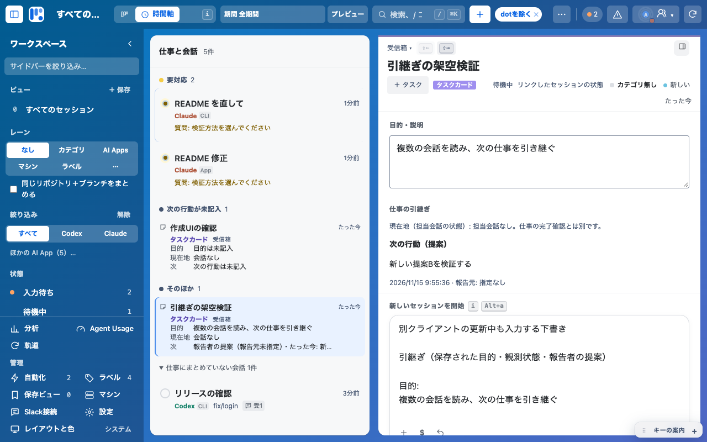
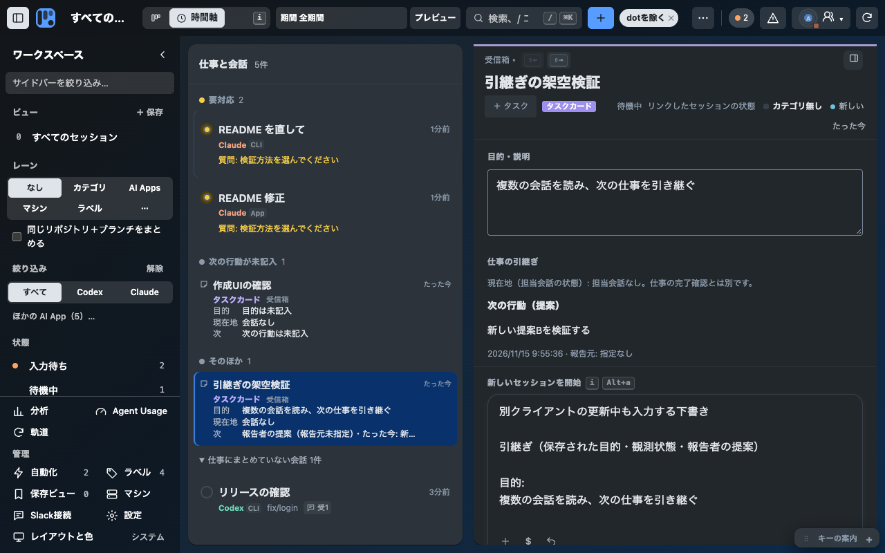

# 引継ぎの現在地を一度に読む（0.29.85）

Claude Desktop Fable 5.2が実CanbanのCodex報告を読み、同じ仕事へ評価を追記した。そこで、get_taskが会話IDしか返さず、現在地を読むために各get_sessionが必要という不足を確認した。

get_taskへ担当会話の薄いsnapshotを追加した。通常ボード取得の導出cacheを別MCPプロセスからも読み、状態・最終assistant抜粋・更新時刻と出典/取得時刻を一度に把握できる。freshも現在実行中かのlive保証ではない。5分経過はstale、未取得/破損/scope不一致はunavailable。発言時刻は未取得ならnullとし、更新時刻で補わない。本文・実行設定・認証値を返さず、cold読取でもprovider走査や認証を起動しない。

cacheは設定・アカウント/home・remote・taskリンク集合にscopeを限定し、600/atomic保存、symlink拒否、並行writerの古い観測による上書き防止を行う。取得/保存失敗でもタスク原文と報告は読める。強制終了で残ったlockの自動奪取はしないため、その場合はsnapshotがstaleのままになる制約がある。

検証: npm test 890/890、Chrome統合smoke成功。boardで仕事を絞り込み除外してもcacheを生成し、別MCPプロセスでproviderを永久pendingにした試験でも一覧走査0回で要約を読めることを確認。実データのscope計算も成功。独立レビューにCritical/Important指摘なし。

UI構造とキーは変更していない。以下は隔離Chromeの架空データ、1280×800ライト/ダーク。自動操作中の拡張URLではERR_BLOCKED_BY_CLIENTを観測したが、その後ユーザーから普段のChromeで「開けた」と確認を得た。仕事を選ぶ操作の受入や、ここに掲載する隔離画面とは区別する。Claude側の既存MCP接続は旧版のままで、当初の読み書きは限定した正規MCP stdioクライアントを利用した。Canbanだけで自律的に相手が発見できることや、人による次の仕事の選択は未確認。

