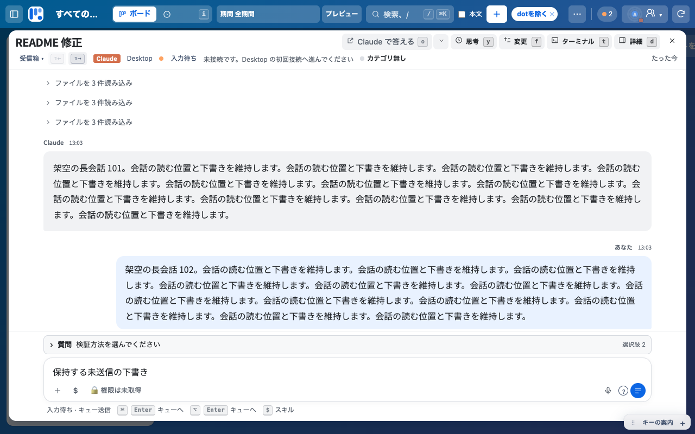
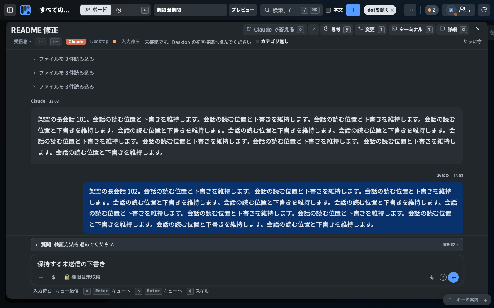
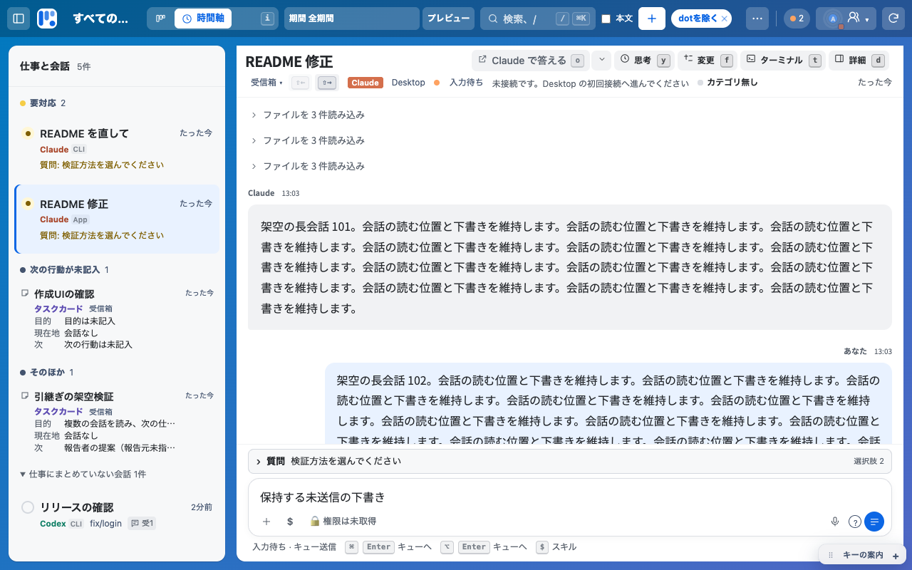
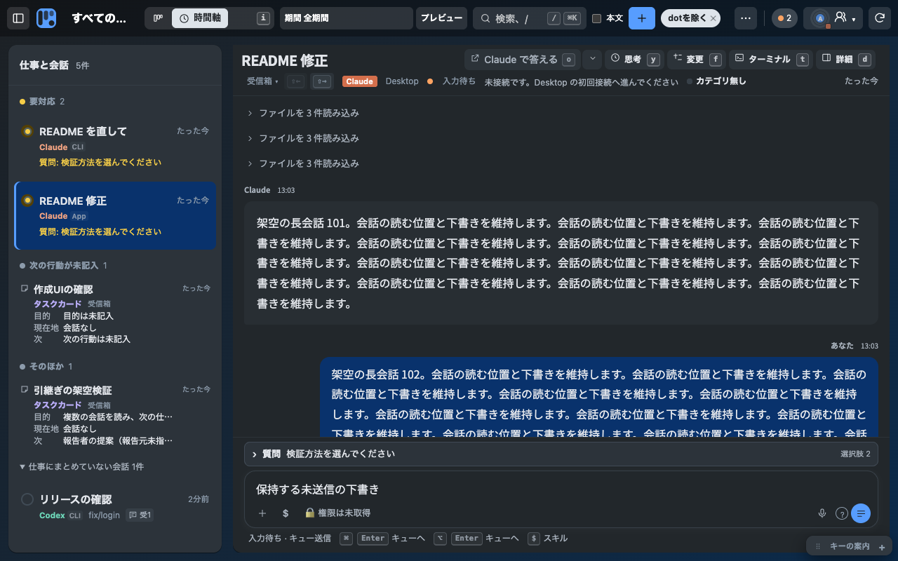
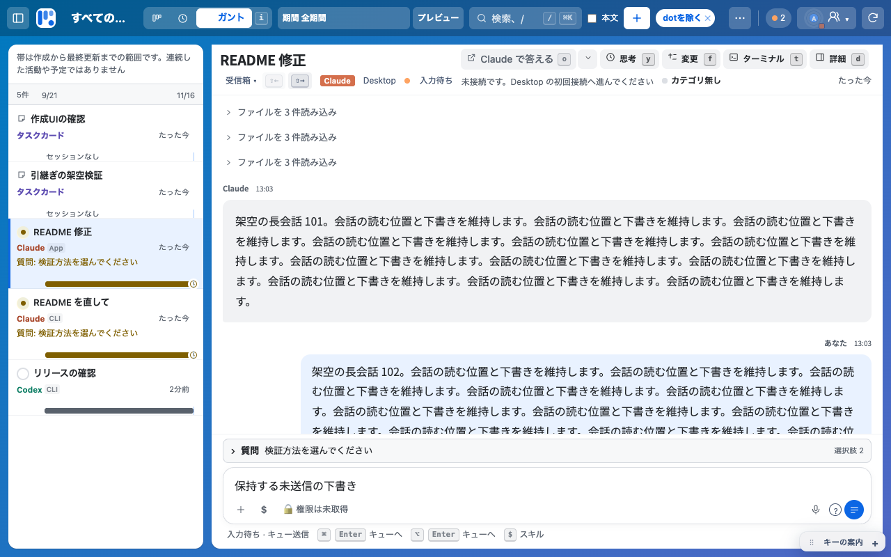
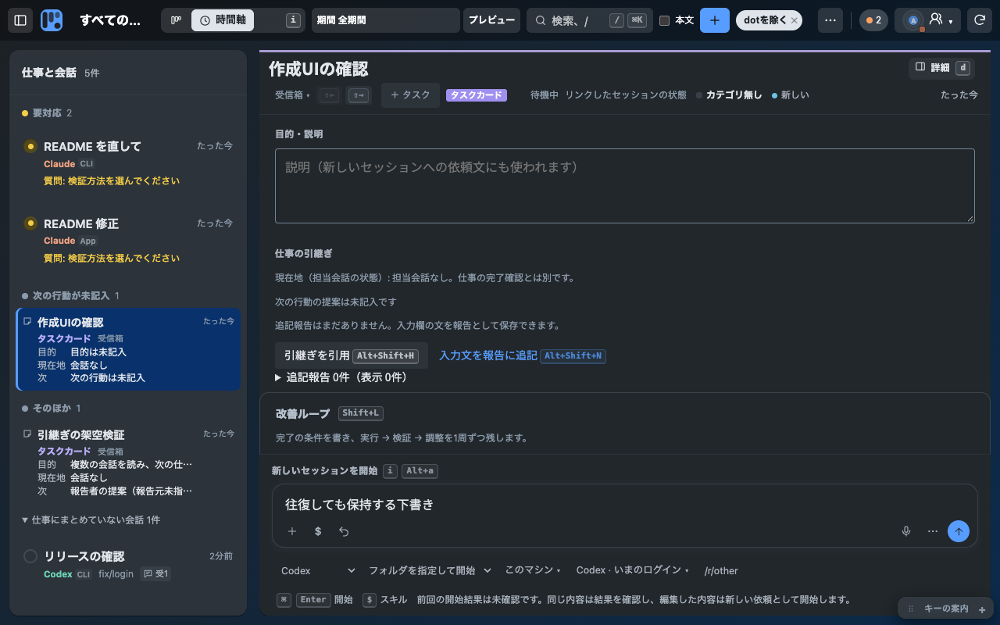

# 会話を広く読む（0.29.86）

ユーザーの登録Chrome画面（0.29.83）をFable 5.2に渡して評価を依頼。本文の高さを奪う3段の見出しと大きなツール履歴、Noto指定がmacOSで選ばれない点を確認した。Codexが既存の共有部品を修正し、Fableへ実装と隔離画面の再評価を依頼し、本文幅を戻す・ガント題名を広げる・Chromeの字体を別ファイルにする指摘を反映した。AntigravityとCodexの現在画面を直接比較したものではない。

題名と操作を1行、パンくずと属性を次の行にまとめる。狭いカードでは操作が折り返す。親タスクの長いパンくずは単行で省略し、操作を維持。折畳みツール履歴は28px程度の行にし、内容とエラー・実行中表示は保持。時間軸の一覧は最大304px、ガントの選択中一覧は最大280pxで題名の下に同じ観測期間の帯を置く。サイドバーの保存された開閉を勝手に変更せず、既存のb／アプリバーの入口で一覧＋会話の2列にできる。カードを閉じたときの下書きと読んでいる位置も従来どおり保持する。

会話・入力・タスク説明と報告にNoto Sans JPを同梱。16px、行間1.8、本文上限60rem（全面表示は従来の1120px上限）（全文を横へ伸ばしすぎない）とする。UI操作やコードの等幅字体は維持。WOFF2は4,350,512バイト、MCP用自己完結HTMLは約7.1MB。Chrome版のCSSは約193KB。Chrome版はローカルWOFF2ファイル参照で、CSSを約5.8MB小さく保つ。MCP Appsはオフライン自己完結のため埋め込み。外部フォント通信・追加権限は不要。SIL OFL全文をソースとChrome配布物へ同梱する。温まったプロセスで10回組立てた中央値は約9.4ms。Chrome初回描画速度の前後比較は未計測で、高速化の主張はしない。MCPホストによる字体の実描画と初回の体感速度は未確認。MCPリソースは字体のbase64により約5.8MB増える制約がある。

## 検証

npm test 892件成功。Chrome smoke成功。架空の220件を追加した長会話を使い、1280×800・ライト／ダークでボード、時間軸、ガントのセッションとタスクを撮影した。新しいレイヤー・キー・画面設定は追加していない。既存のb（サイドバー）、Enter（拡大）、Esc（戻る）、d/f/y/t（補助列）を維持。送信前の権限確認とアプリ側承認の境界は変更していない。既存toolGroupで作った架空のツール群3件の高さと開閉も確認した。権限取得済み・制限なしの実画面とユーザー窓サイズでの受入は未確認。

| 1280×800・補助列を閉じた同じ架空会話 | 前 | 後 |
|---|---:|---:|
| ボードの会話高さ | 443.7px | 481.5px |
| 時間軸の会話高さ | 447.7px | 485.5px |
| 時間軸のカード幅 | 843px | 936px |
| ガントのカード幅 | 924px | 964px |
| ツール群1件の閉じた行 | 45.5px | 28px |
| 下書き・カーソル選択・フォーカス | 保持 | 保持 |
| resize時のスクロール差 | 0px | 0px |

beforeはorigin/mainのCSSと見出し構造を同じ隔離ページで復元し比較。アプリバー1本、既存入口からサイドバーと補助列を閉じて比較した。登録Chromeの実データ・実ウィンドウの受入とは区別する。変更前後の全画像と条件は.local/ui-ux-checks/2026-11-15-reading-space/に保存。

