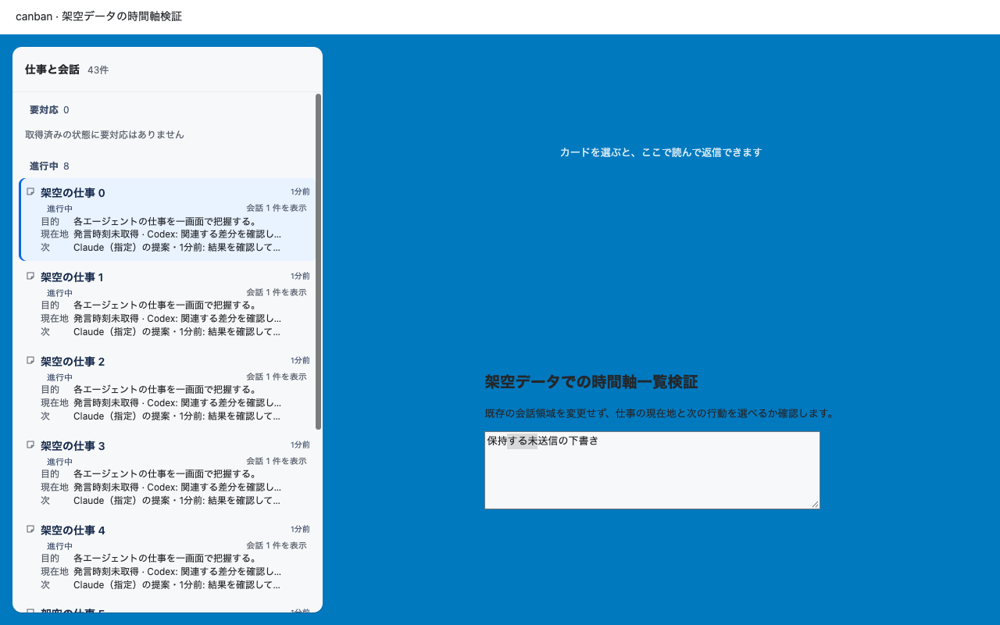
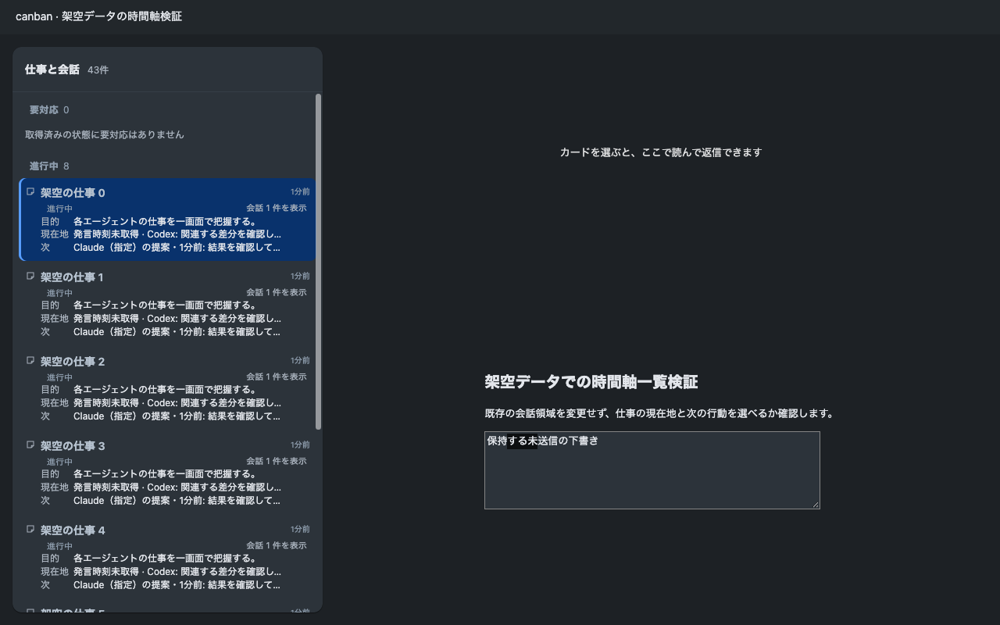
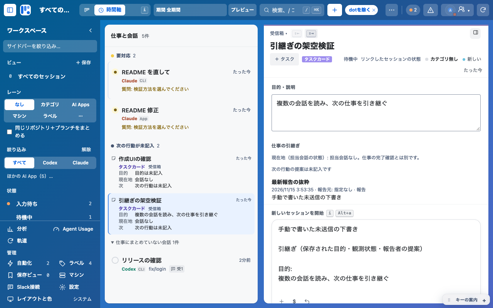
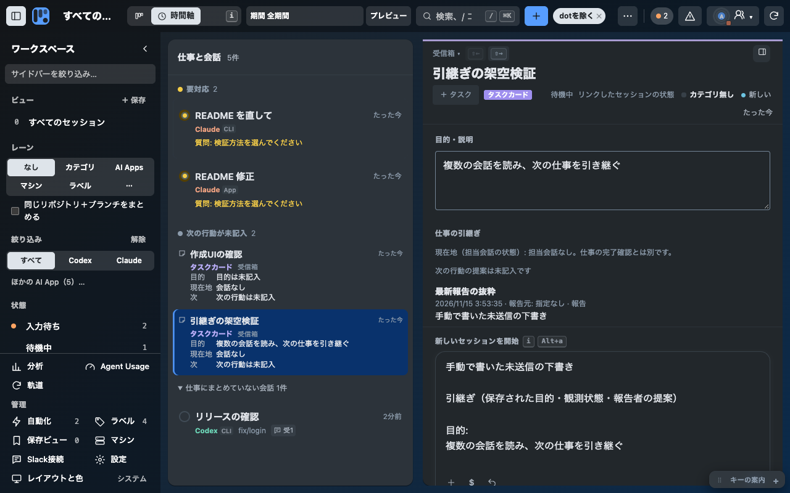

# 仕事の全体像と次の行動

2026-11-15。ユーザーの最優先は「仕事の全体像や、次に取り組む仕事が分からない」。Claude Desktop Fable 5.2が実Canbanのタスク/会話を読んだ設計レビューを受け、Codexが実装した。

## 変更

従来は会話とタスクが時刻の区分に並び、タスクの行は会話数を示すだけだった。時間軸の仕事一覧に目的・観測した現在地・明示された次の行動を出し、質問、停止、未読などの理由で要対応を示す。仕事完了と会話の応答終了は区別する。明示していない次の行動や発言時刻を推測しない。定期会話は畳むが、独立した実行中/要対応会話は隠さない。

仕事の説明を副作用なく読めるAPIと追記報告を追加。既存の依頼欄を引用と報告にも使う。引用は末尾へ足し、報告保存は送信せず下書きを保持する。指定した報告元を認証済み作者と扱わず、次の行動は提案として示す。

ローカルCodex会話の取得を全provider一覧から分離。関連セッションのsnapshot/未取得を明記し、再試行で入力欄を作り直さない。権限のfallbackは元のセッションで確認した権限と区別する。

## 検証と限界

- 最終 `npm test`: 875/875成功、失敗/skip 0。途中で旧文言の期待値を更新し、既存ログインPTY終了fixtureの時間切れ1件は単独20/20と最終の全体検証で成功を確認。時間切れの原因は断定していない。
- 隔離Chrome 1280×800: 架空の仕事8件と定期会話35件。5仕事を画面内で視認、35件を折り畳み、3回更新の位置ずれ0px。下書き、選択範囲、フォーカス保持。
- 更新4.0/4.2/2.9msは部品の再描画のみ。実データやカードを開いて本文が使えるまでの速度ではない。従来の同条件時間は測定しておらず、速度改善率は主張しない。
- 会話詳細回帰は、他provider一覧が永久pendingでも選択したCodex会話/権限を返す架空fixtureで確認。過去の実データ診断では一覧再取得が222.8秒に達したが、fixture時間との直接比較はしない。
- Chrome統合smoke: 全経路成功。仕事の引用/報告API読み戻しとエージェント送信0、詳細失敗→再試行→成功時の下書き/選択範囲/読む位置/権限表示を実部品で確認。
- 添付不具合と一致する実Codex会話の新ソース側詳細取得: 2026-11-14T18:50:10Z、905ms、feed 3件、14,955 bytes。関連情報は未取得、権限sourceはfallback。登録Chromeの復旧や全providerの速さは未確認。
- 以下は隔離した部品の画像。登録Chrome・実データ・元アプリの実行成功を証明しない。Claude Desktopの現物画面による比較は未実施。

実部品による仕事カードと追記報告（隔離Chrome、架空データ、1280×800）:

## レイヤーとキー

レイヤー1: 未整理会話の開閉 `Alt+U`。レイヤー2: 仕事から引継ぎを引用 `Alt+Shift+H`、入力文を報告追記 `Alt+Shift+N`。既存⌘K・隣接ヒント・キー一覧に揃えた。新しいページや常設パネルは追加していない。

## 残る受入

統合smokeとカードの撮影、PR/CI/main、登録版更新、実Canbanを介したClaudeへの結果回収、人が実データから次の仕事を選べることを別々に確認する。人によるループ完了確認はモデル報告で代替しない。

Claudeとの実往復は、Codex報告をCanbanへ追記したところまで。現在macOSがosascript補助アクセスを-25211で拒否し、Claude Desktopへの入力は人の操作待ち。登録版の画面受入とともに未確認として残す。別経路での回避は行わない。
