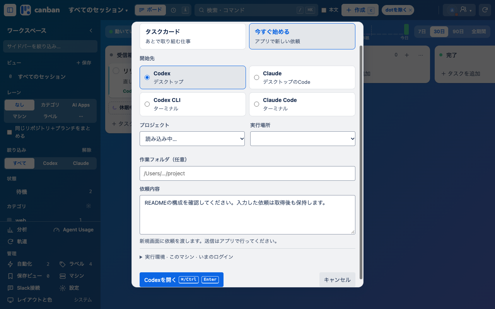
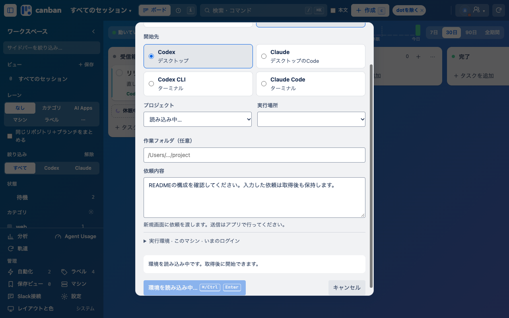
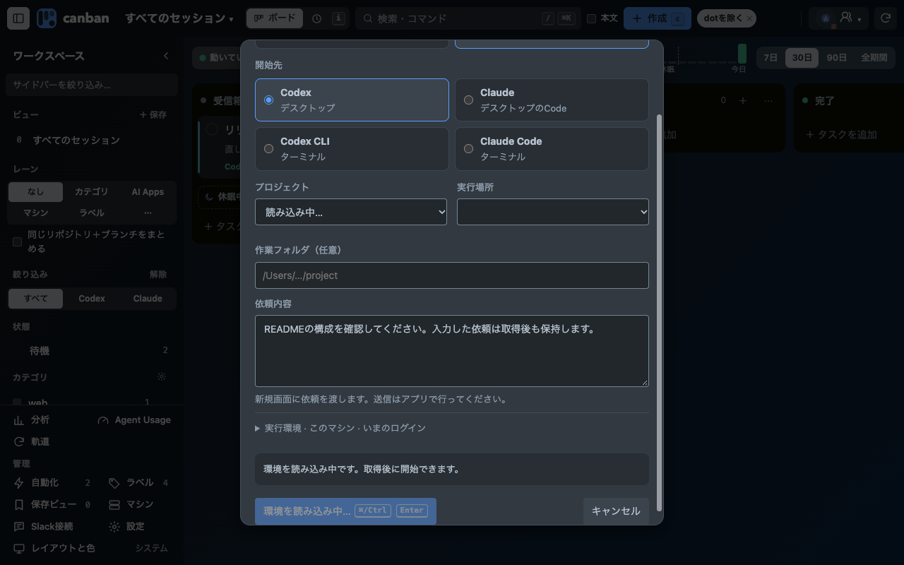
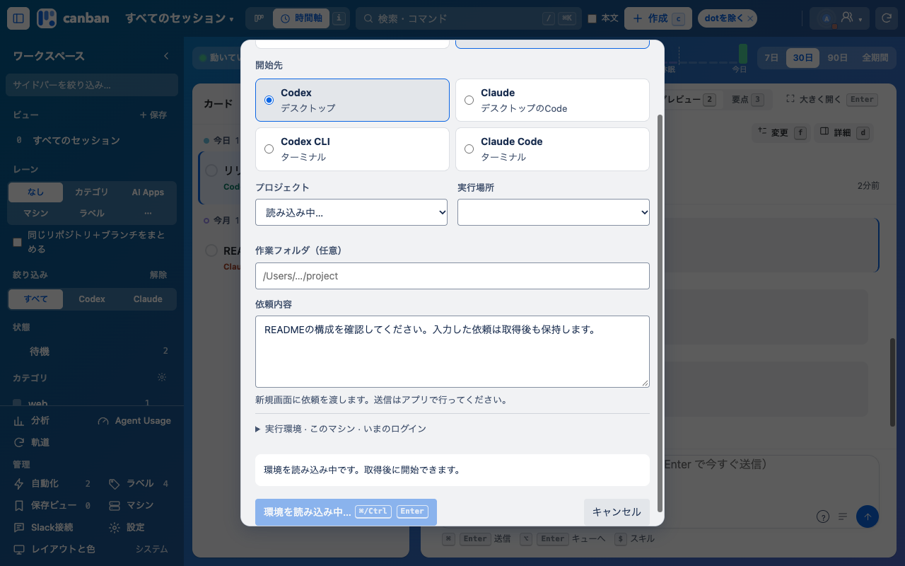
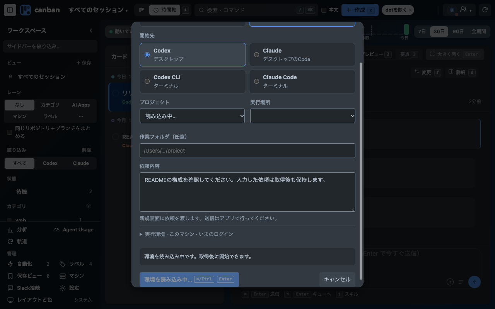
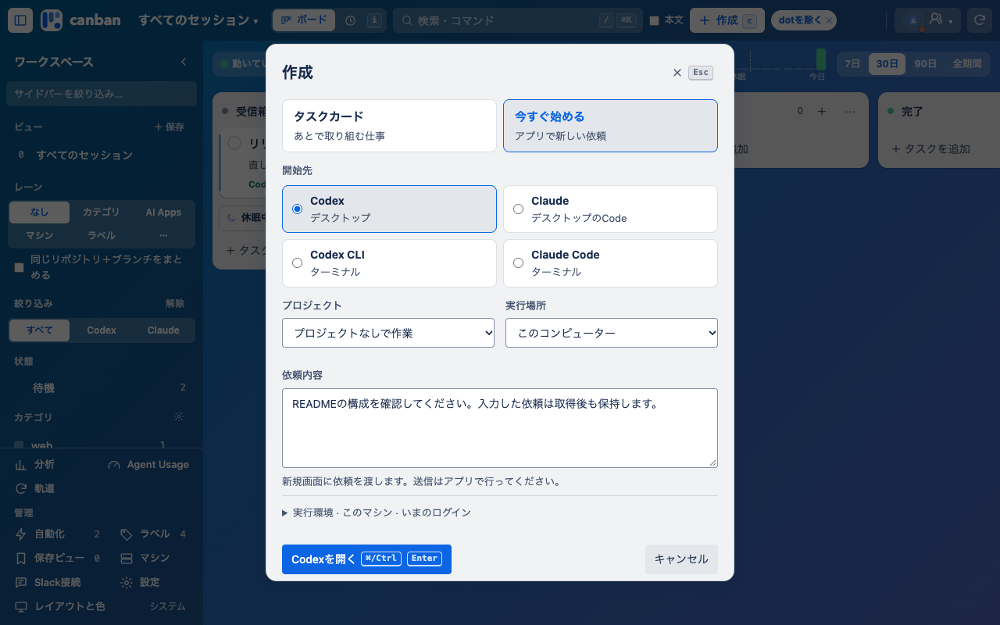

# 開始先の読み込み状態 0.29.17

「今すぐ始める」でデスクトップの環境・プロジェクト取得中に開始を押すと、ボタンは有効なのに何も起きない状態を修正します。取得中は開始ボタンを無効にして読み込み表示へ変え、⌘/Ctrl+Enterには既存の状態メッセージで案内します。取得後は通常の開始へ戻り、入力した依頼を保持します。CLIと、取得失敗後の既存の手入力経路は待機対象にしません。

## 条件と結果

Chrome・1280×800・架空データ。開始先の応答をテスト側で保留し、同じCtrl+Enter操作を行います。ボタンの確認にはダイアログ内をスクロールしています。実アプリを開く操作や実会話への送信は行っていません。

| 条件 | 取得中のボタン | ショートカットの案内 | 取得後 | 下書き |
|---|---|---|---|---|
| 変更前・4条件 | 有効 | なし | 有効 | 保持 |
| 変更後・4条件 | 無効・読み込み中 | 読み込み中の案内 | 有効 | 保持 |

4条件はボード／時間軸×ライト／ダークです。読み込み時間はテストで保留しているため性能値として扱いません。Codex／Claude Desktopの現在の比較画面は未確認です。

- npm test: 497件成功。
- node --test tests/board-smoke.browser.mjs: 成功。
- 遅延取得・CLI・取得失敗時の手入力継続・下書き保持の関連テスト成功。
- Chromeビルド・差分チェック成功。Standards／Specの独立レビューは指摘なし。

既存の作成ダイアログ（レイヤー3）だけを変更。c・⌘K・⌘/Ctrl+Enter・Escを維持し、新しい操作・ページ・設定・権限は追加していません。登録済み拡張への更新とは別の、隔離環境の検証結果です。

## 変更前

## 変更後・取得中

## 取得完了後

