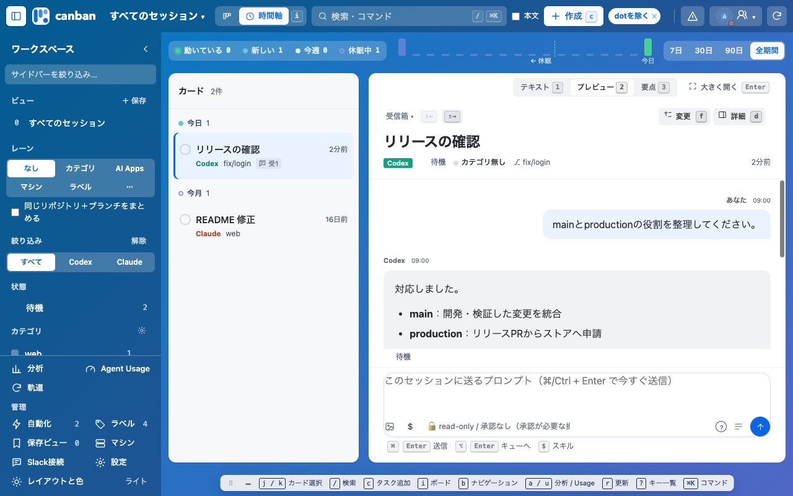
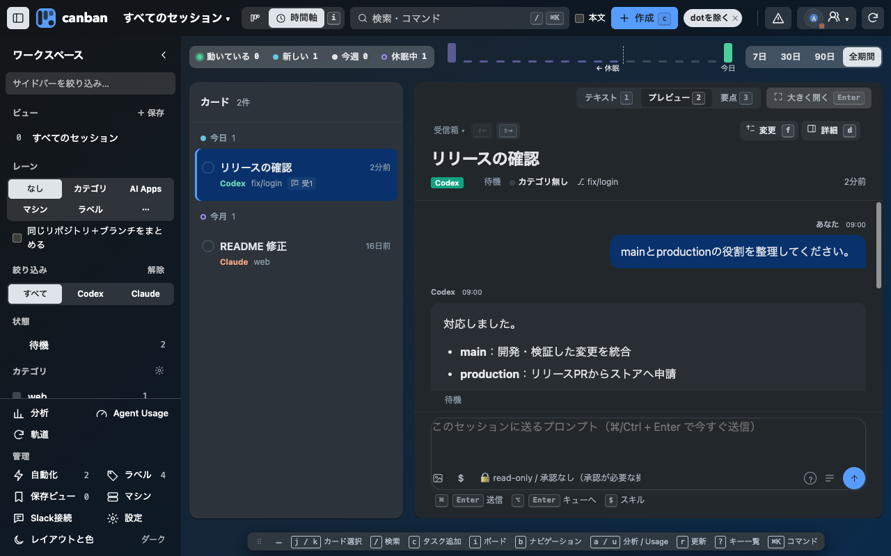
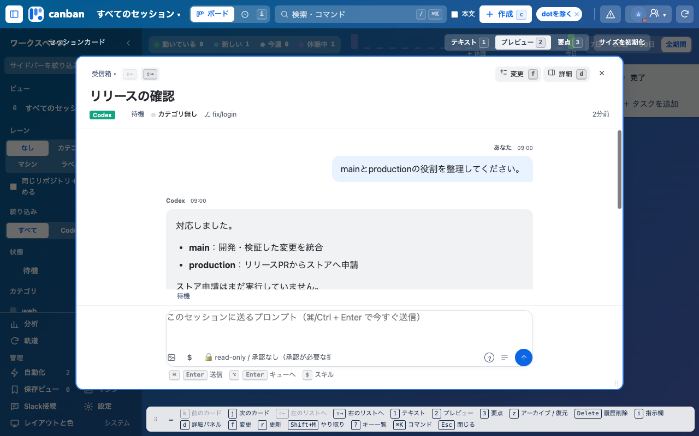
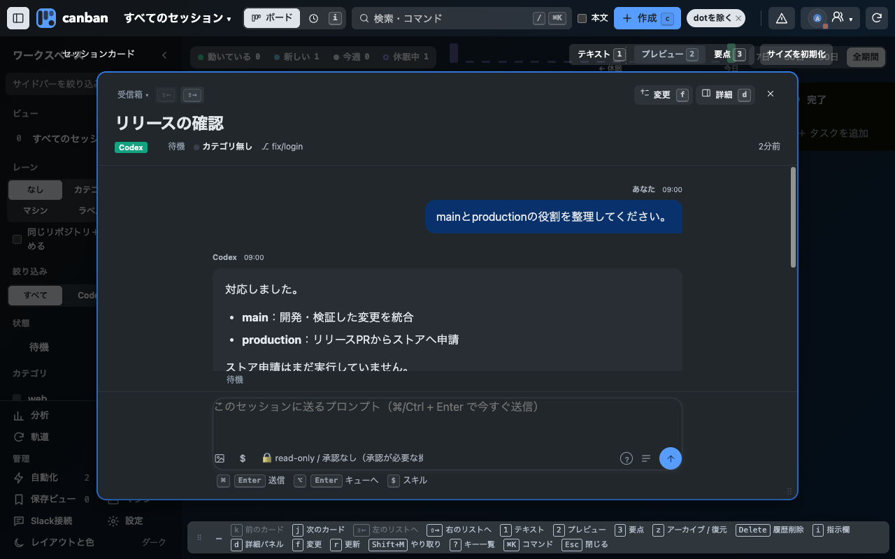
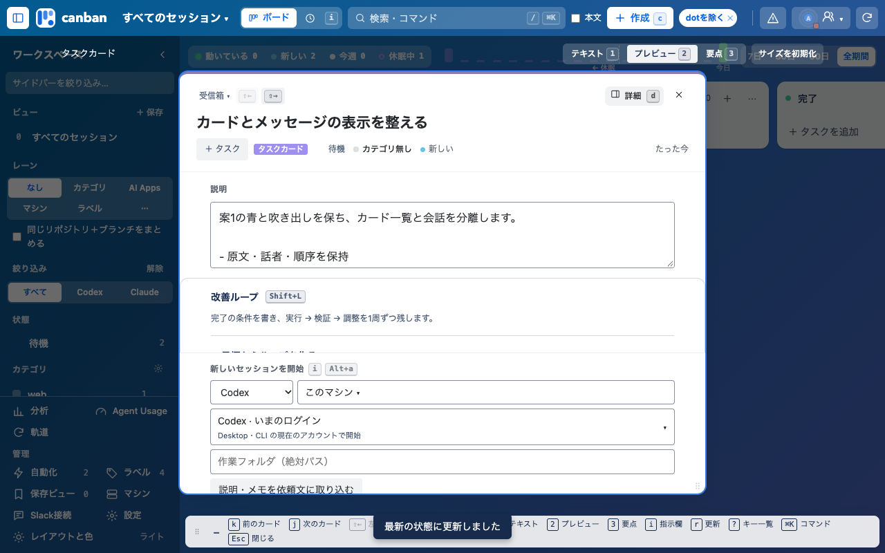
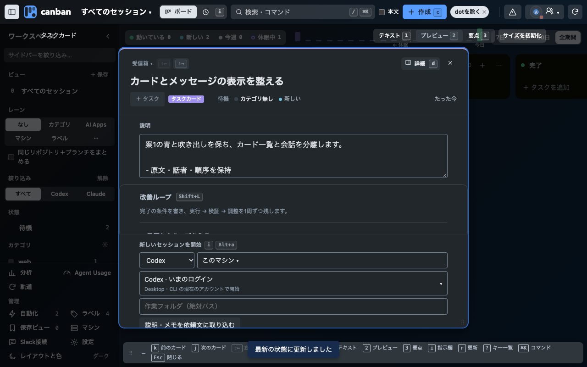

# カードとメッセージの分離 0.29.8

採用案1の青と吹き出しを既存部品へ反映し、時間軸のカード一覧と会話を16pxの間隔で分けました。ボードから開くカード詳細も共通の文字組みです。新しい操作・ページ・設定は追加していません。

すべて架空の会話を使った隔離HTTP環境をChromeで1280×800にして撮影しています。登録済みChrome拡張の実画面を証明する画像ではありません。

- 全5配置 × ライト／ダーク × ボード／時間軸を確認。タスク詳細はライト／ダークを確認。
- 追加のタスク属性検証で「タスクカード」が1回だけ表示されることを確認。
- 会話の原文・話者・有効な時刻、詳細パネル、表示切替、スクロール・下書き・入力フォーカスを確認。実会話へは送信していません。
- 過去閲覧中の更新前後はscrollTop 2879pxを保持。末尾の新着追従後の残りは0.5px。本文16px・行間28px。
- キャッシュ済み架空カードを開く計測は中央値5.3ms、最大22.0ms（20条件）。変更前との同条件比較がないため速度改善とは評価しません。
- 現在のCodex／Claude Desktopとの同条件比較は未確認です。

レイヤーは既存のボード面1・カード詳細2。操作とキーは既存のまま（i・Enter・Esc・r・d・f・1/2/3）。

## 検証結果

npm testは472件成功。既定ブラウザースモーク、全配置の視覚検証、Chromeビルド、差分チェックが成功し、独立したStandards／Specレビューは指摘0件です。監視テストの固定待機は、2秒DBポーリングを含めて通知の静穏を確認する待機へ変更しました。製品の監視処理と判定条件は保持しています。

## 時間軸

## ボードのカード詳細

## タスク詳細

