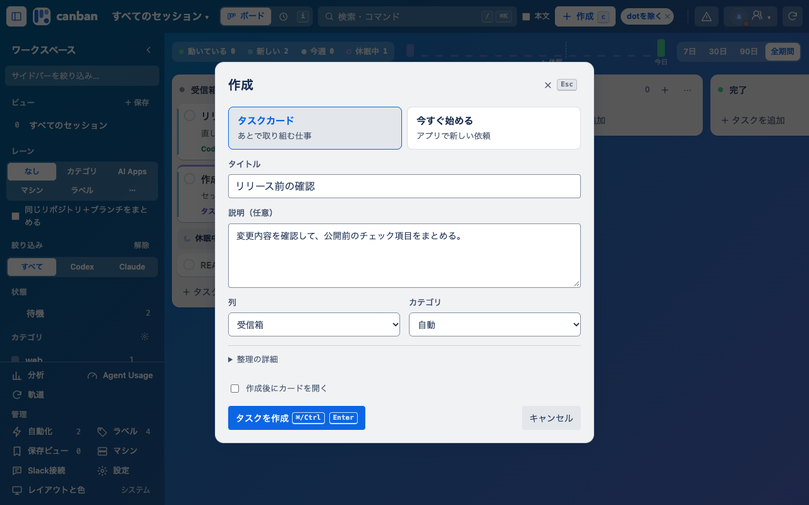
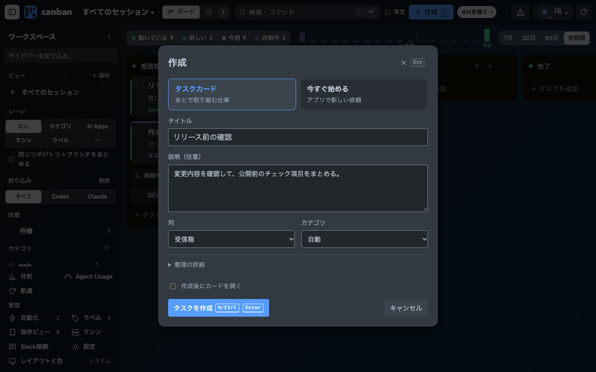
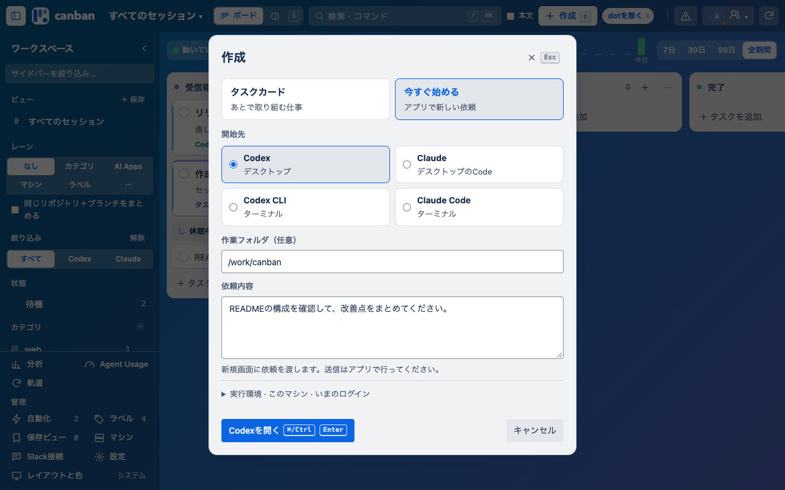
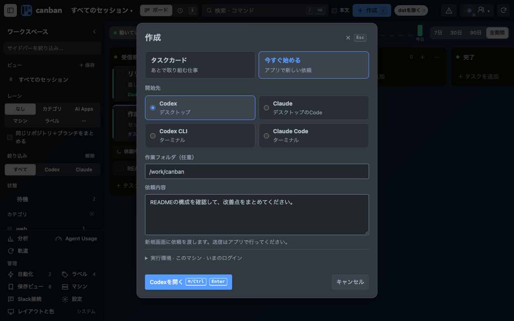
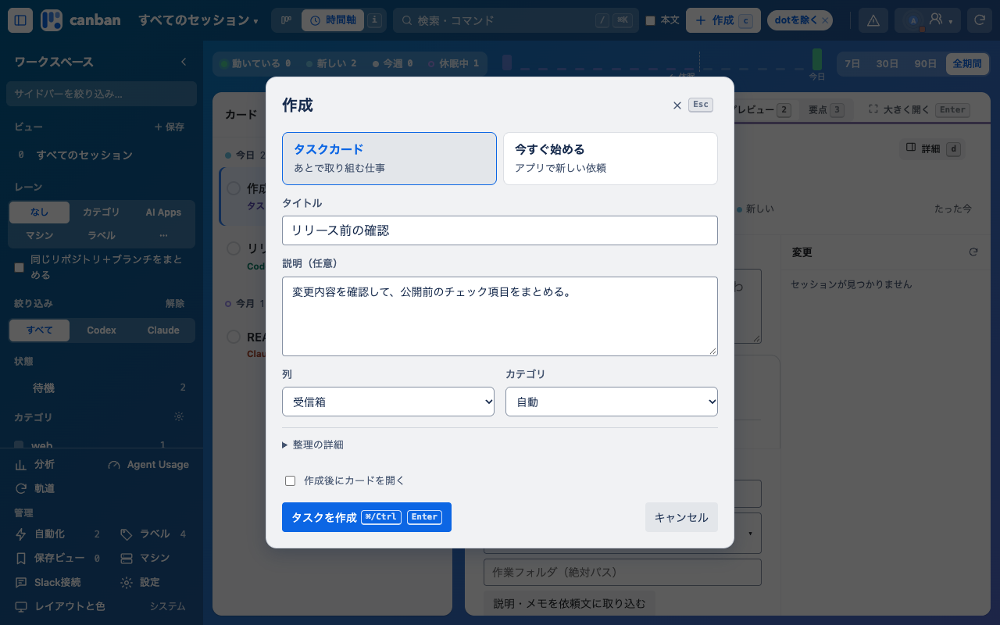
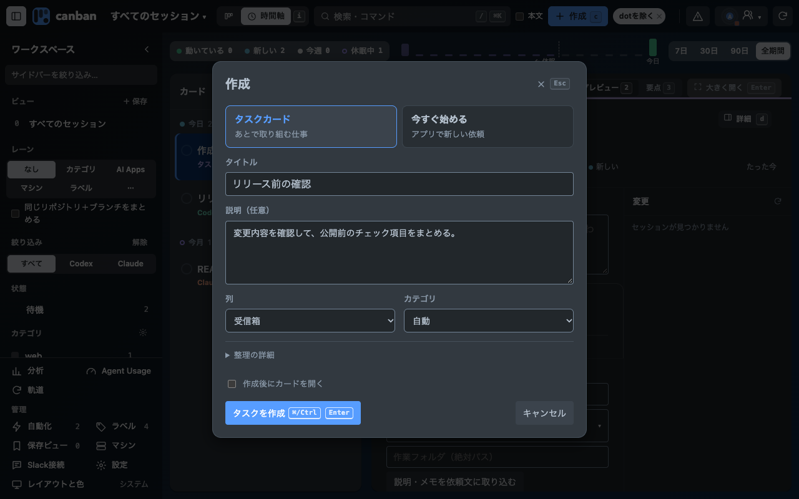
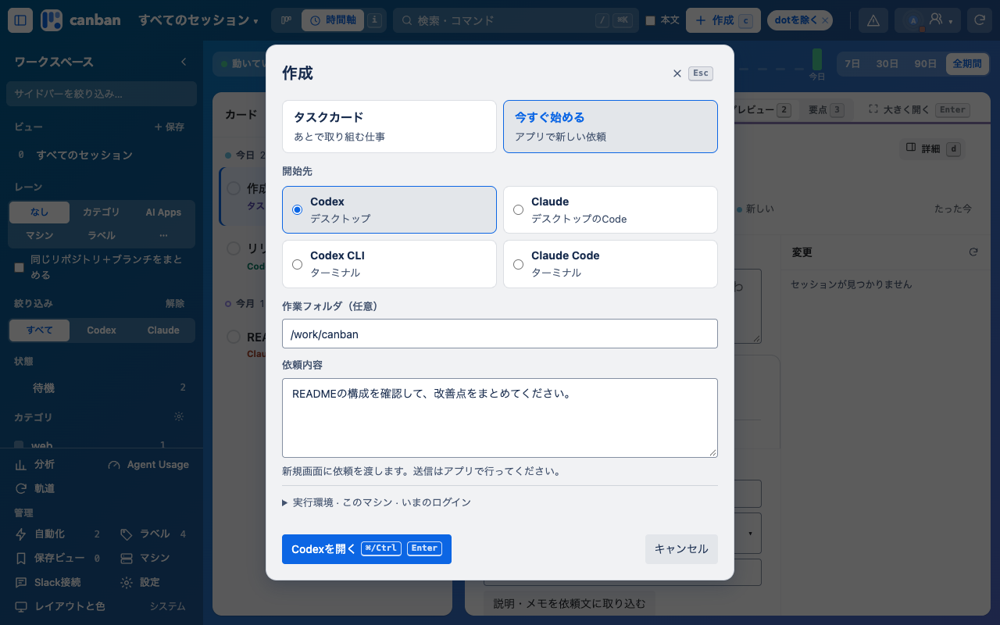
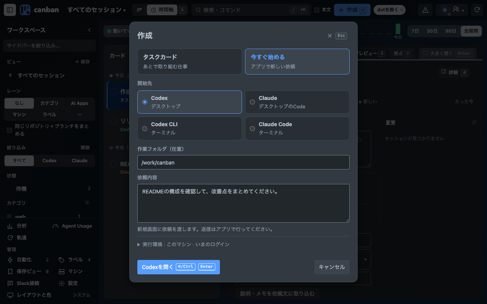

# 作成ダイアログ 0.29.9

作成の入口で「タスクカード」と「今すぐ始める」を選びます。即時開始はセッションだけを扱い、タスクカードを作りません。開始先はCodex・Claudeのデスクトップ、Codex CLI・Claude Code CLIです。デスクトップでは依頼文付きの新規画面を開き、送信・実行開始はアプリで確認します。

すべて架空のデータを使った隔離HTTP環境で、Chromeを1280×800にして撮影しました。登録済み拡張や実アプリで送信した証拠ではありません。

- ボード／時間軸 × ライト／ダーク × タスク／即時開始の8条件。
- 種類・開始先の切り替え、下書きの保持、開始先のキーボードフォーカス、IME確定と送信の区別、タスクの保存を検証。
- 起動はdry-run。実セッションへの依頼は送信していません。
- レイヤー3。c・⌘Kで開き、⌘/Ctrl+Enterで作成または開始、Esc・背景クリックで閉じます。

| 表示 | ライト | ダーク |
|---|---|---|
| ボード・タスク |  |  |
| ボード・即時開始 |  |  |
| 時間軸・タスク |  |  |
| 時間軸・即時開始 |  |  |

検証コマンド: `npm test`、`CANBAN_CREATION_SHOTS=.local/creation-screenshots node --test tests/board-smoke.browser.mjs`、`npm run build:chrome`。
